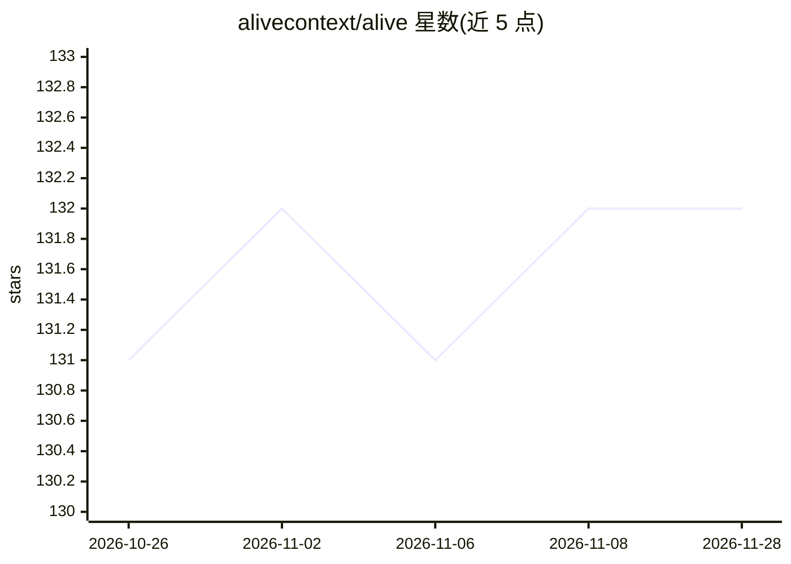

# alivecontext/alive

⭐ 132 · Python · MIT · 推送 2026-11-18 · [GitHub](https://github.com/alivecontext/alive) · [官网](https://alivecontext.com) · 个人维护

**为 Claude Code 提供基于本地文件夹的会话记忆管理插件**

以 Claude Code 插件形式发布（v3.2.6，MIT，research preview），在用户磁盘上以纯文件夹保存会话上下文，使跨会话延续工作状态。提供 18 个斜杠技能：world 初始化、save/load-context 保存与恢复、capture-context 导入邮件/转录/文件、create-walnut 建立项目条目、search-world 搜索、session-history 查看历史、build-extensions 自定义技能等。依赖 Claude Code 与 Python 3，经 plugin marketplace 安装；README 声明已不再积极维护。

## 筛选速览

| 维度 | 判定 | 备注 |
|---|---|---|
| AI 角色 | `ai-ecosystem` | LLM/agent 周边工具 |
| 许可风险 | `permissive` | MIT |
| 部署形态 | `None` |  |
| 模型依赖 | — | README 未给出锁定关系 |
| 硬件要求 | — | 无带数字的原话,不猜 |
| 安装摩擦 | `low` | 无编译、无系统依赖或容器化 |
| 成熟度 | `idea` | |

## 能力要点

- 基于本地磁盘文件夹的持久化上下文存储，数据留在用户自己机器上
- 18 个斜杠技能覆盖保存、恢复、搜索、导入、升级等上下文操作
- /alive:system-upgrade 支持 v1–v3.2 升级，先展示计划并备份
- 提供 build-extensions 技能供用户自建技能、规则与 hooks

## 适用场景

- 让 Claude Code 在多次会话间延续同一个项目的上下文
- 把邮件、转录、文件等材料导入后供 Claude Code 检索使用
- 以地图形式查看并搜索自己的项目与工作记录

## 场景标签

`知识库管理` `Agent 记忆` · 领域:Agent 开发

## 证据(README 行号)

> L3:  Claude Code forgets everything when a chat ends. ALIVE gives it a memory that lives in plain folders on your own co
> L20: claude plugin marketplace add alivecontext/alive
> L21: claude plugin install alive@alivecontext

## 星数曲线

2026-10-26 131 → 2026-11-28 132（+1）

---
*卡片 v1 · prompt 1.4 · 生成 2026-11-28 · 置信度 high · 依据 README sha `c9edc701437f` · [字段定义](../../DATASET.md)*
