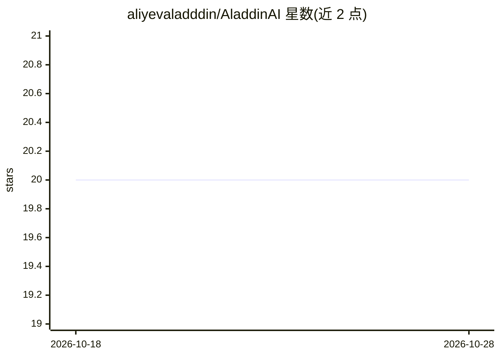

# aliyevaladddin/AladdinAI

⭐ 20 · Python · Apache-2.0 · 推送 2026-10-27 · [GitHub](https://github.com/aliyevaladddin/AladdinAI) · [官网](https://aladdinai.cc) · 个人维护

**自托管 BYOI AI Agent 平台：接入自有基础设施构建管理智能体**

开源的自托管 AI Agent 平台（Apache 2.0，个人开发者维护）。用户接入自有服务器、NVIDIA NIM、OpenAI、Anthropic 或 Ollama，通过 Web 界面创建和管理按用户隔离的 Agent（各自模型、系统提示词、工具集与安全栈）。功能包括多 Agent 协作编排、基于 MongoDB Atlas 向量检索的记忆系统、CRM/订单模块、Telegram/WhatsApp/邮件等渠道、语音（Riva ASR）、文档索引、浏览器终端与 Cron 触发任务。安装仅需 Docker，通过 npx aladdin-ai 一条命令拉取 GHCR 镜像启动全栈（Next.js 前端 + FastAPI 后端）。README 自述处于积极开发中，多数功能端到端可用。

## 筛选速览

| 维度 | 判定 | 备注 |
|---|---|---|
| AI 角色 | `ai-native` | 本体是模型或模型工具 |
| 许可风险 | `permissive` | Apache-2.0 |
| 部署形态 | `self-host` | docker 或自建部署 |
| 模型依赖 | local-ok | 支持本地模型 |
| 硬件要求 | — | 无带数字的原话,不猜 |
| 安装摩擦 | `low` | 无编译、无系统依赖或容器化 |
| 成熟度 | `idea` | |

## 能力要点

- BYOI 架构：接入 NIM/OpenAI/Anthropic/Ollama 等自有 LLM Provider
- 多 Agent Swarm 编排与 MongoDB Atlas 向量记忆（含安全门控与 PII 脱敏）
- npx aladdin-ai 一条命令经 Docker 拉起全栈（amd64/arm64 镜像）
- 内置 CRM、订单、多渠道消息、语音与浏览器终端模块

## 适用场景

- 在企业自有基础设施上部署数据可控的 AI Agent 平台
- 通过 Telegram/WhatsApp/邮件等渠道用 Agent 处理客户沟通与 CRM 记录
- 为 Agent 配置定时任务、工具集与安全门控并审计调用轨迹

## 场景标签

`多智能体` `Agent 框架` `Agent 记忆` · 领域:Agent 开发

## 证据(README 行号)

> L27: Connect your own servers, NVIDIA NIM, OpenAI, Anthropic, or Ollama — build and manage AI agents visually with compl
> L49: |**Agents**|Per-user agents with their own model, system prompt, tool set, and safety stack (NemoGuard / Llama-Guar
> L95: Open `http://localhost:3000`, register a user, and land on the dashboard.

## 星数曲线

2026-10-18 20 → 2026-10-28 20（+0）

---
*卡片 v1 · prompt 1.4 · 生成 2026-10-28 · 置信度 high · 依据 README sha `869cd8bc519b` · [字段定义](../../DATASET.md)*
