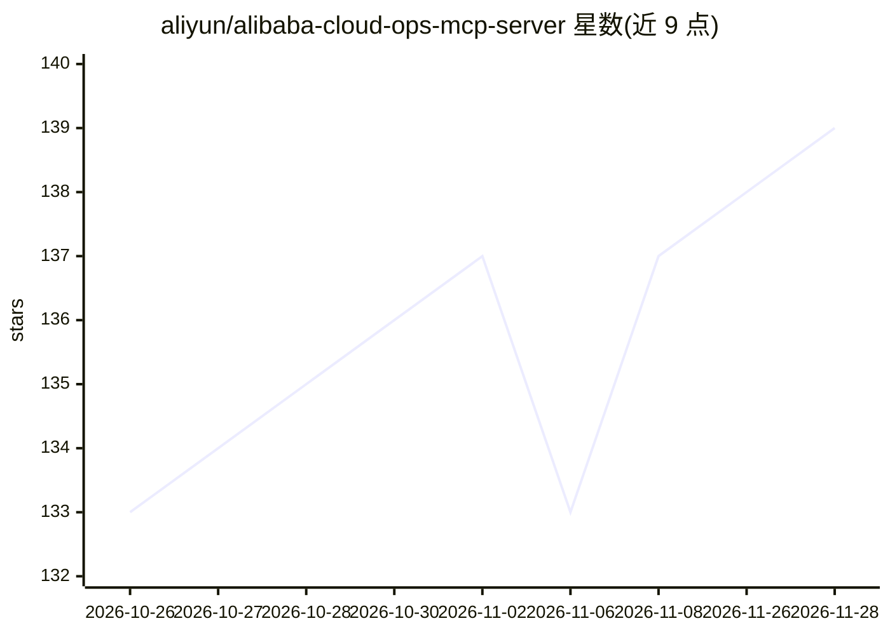

# aliyun/alibaba-cloud-ops-mcp-server

⭐ 139 · Python · Apache-2.0 · 推送 2026-11-17 · [GitHub](https://github.com/aliyun/alibaba-cloud-ops-mcp-server) · 组织维护 · 中文 README

**让 AI 助手操作阿里云资源的 MCP 服务器**

一个 Model Context Protocol 服务器，对接阿里云 API，使 AI 助手能对阿里云资源执行操作，覆盖 ECS、VPC、RDS、OSS、云监控、OOS 等产品，提供实例生命周期管理、监控指标读取、应用部署与本地项目分析等工具集（约 30 个工具）。可通过 Qoder、Cursor、Cline、ModelScope、Lingma 等 MCP 客户端/市场集成，依赖 uv 运行，配置中需提供阿里云凭证。

## 筛选速览

| 维度 | 判定 | 备注 |
|---|---|---|
| AI 角色 | `ai-ecosystem` | LLM/agent 周边工具 |
| 许可风险 | `permissive` | Apache-2.0 |
| 部署形态 | `None` |  |
| 模型依赖 | — | README 未给出锁定关系 |
| 硬件要求 | — | 无带数字的原话,不猜 |
| 安装摩擦 | `low` | 无编译、无系统依赖或容器化 |
| 成熟度 | — | 结构信号不足 |

## 能力要点

- 覆盖 ECS/VPC/RDS/OSS/云监控/OOS 的 MCP 工具集
- 应用部署工作流：本地分析技术栈→构建→OOS_CodeDeploy 部署→查询状态
- 可在 Cursor、Cline、ModelScope、阿里云百炼等 MCP 市场安装集成
- 开箱即用，支持通过阿里云 OpenAPI 动态生成工具

## 适用场景

- 通过 AI 助手管理阿里云 ECS 实例的启动、停止与命令执行
- 让 AI 读取 ECS 的 CPU、内存、磁盘监控指标
- 从本地项目自动识别技术栈并部署到 ECS
- 用 AI 助手查看和操作 RDS、VPC、OSS 资源

## 场景标签

 · 领域:云基础设施/DevOps

## 证据(README 行号)

> L9: Alibaba Cloud Ops MCP Server is a Model Context Protocol (MCP) server that provides seamless integration with Alibab
> L11: ## MCP Maketplace Integration

## 星数曲线

2026-10-26 133 → 2026-11-28 139（+6）

---
*卡片 v1 · prompt 1.4 · 生成 2026-11-27 · 置信度 high · 依据 README sha `460e6184337c` · [字段定义](../../DATASET.md)*
