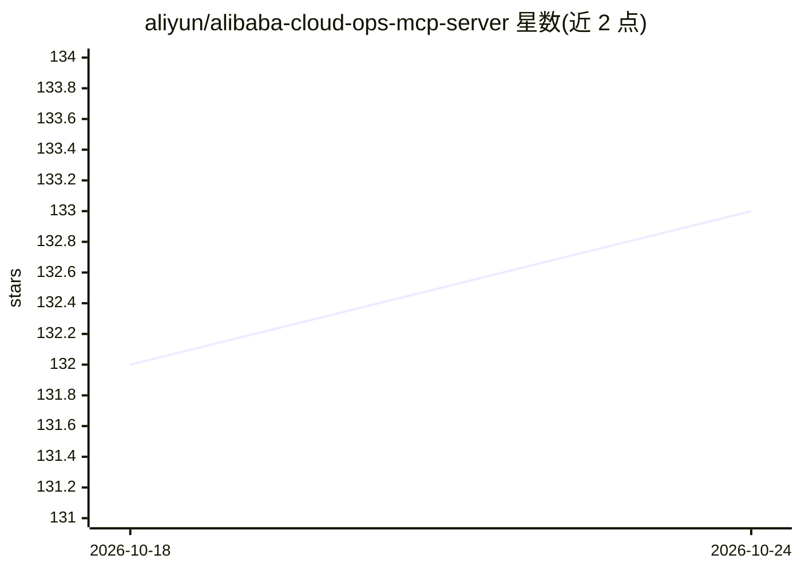

# aliyun/alibaba-cloud-ops-mcp-server

⭐ 133 · Python · Apache-2.0 · 推送 2026-10-21 · [GitHub](https://github.com/aliyun/alibaba-cloud-ops-mcp-server) · 组织维护 · 中文 README

**让 AI 助手操作阿里云资源的 MCP 服务器**

阿里云开源的 Model Context Protocol 服务器，封装阿里云 OpenAPI 与 OOS，使 AI 助手能够管理 ECS、VPC、RDS、OSS、云监控等云产品资源，并支持分析本地项目技术栈、构建产物并通过 OOS 部署应用到 ECS 实例（含自动上传 OSS、创建应用与分组）。部署流程为本地分析→构建→部署→状态查询四步。可通过 Cursor、Cline、ModelScope、百炼平台等 MCP 客户端接入，使用前需安装 uv 并配置 AccessKey。

## 筛选速览

| 维度 | 判定 | 备注 |
|---|---|---|
| AI 角色 | `ai-ecosystem` | LLM/agent 周边工具 |
| 许可风险 | `permissive` | Apache-2.0 |
| 部署形态 | `None` |  |
| 模型依赖 | — | README 未给出锁定关系 |
| 硬件要求 | — | 无带数字的原话,不猜 |
| 安装摩擦 | `low` | 无编译、无系统依赖或容器化 |
| 成熟度 | — | 结构信号不足 |

## 能力要点

- ECS/VPC/RDS/OSS/云监控等产品的管理与监控工具集
- OOS_CodeDeploy 一键部署应用到 ECS（自动创建应用与分组、上传 OSS）
- 本地项目技术栈识别（npm/Python/Java/Go/Docker 等）
- 已上架百炼 MCP Marketplace、Cursor、Cline 等多个 MCP 市场

## 适用场景

- 通过 AI 助手对话式创建、启停、删除阿里云 ECS 实例
- 让 AI 分析本地项目并部署到阿里云 ECS
- 用 AI 查询 ECS 的 CPU/内存/磁盘监控指标

## 场景标签

 · 领域:云计算/AI 工具生态

## 证据(README 行号)

> L7: Alibaba Cloud Ops MCP Server is a Model Context Protocol (MCP) server that provides seamless integration with Alibab
> L45: To use `alibaba-cloud-ops-mcp-server` MCP Server with any other MCP Client, you can manually add this configuration

## 星数曲线

2026-10-18 132 → 2026-10-24 133（+1）

---
*卡片 v1 · prompt 1.4 · 生成 2026-10-23 · 置信度 high · 依据 README sha `97ce8f445cbe` · [字段定义](../../DATASET.md)*
