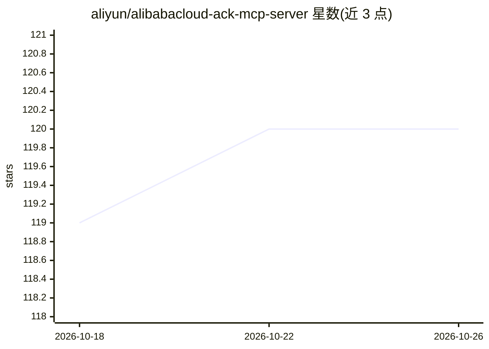

# aliyun/alibabacloud-ack-mcp-server

⭐ 120 · Python · Apache-2.0 · 推送 2026-07-31 · [GitHub](https://github.com/aliyun/alibabacloud-ack-mcp-server) · 组织维护 · 中文 README

**面向 AI Agent 的阿里云 ACK/K8s 容器运维 MCP 工具集**

阿里云容器服务官方维护的 MCP Server，将 ACK 集群管理、Kubernetes 原生 kubectl 操作、Prometheus/SLS 可观测性查询、审计日志与诊断巡检等能力封装为标准化工具集，供 AI 助手与第三方 AI Agent 通过自然语言调用，构建容器场景 AIOps。已被阿里云容器服务智能助手集成，也支持 Claude Code、Cursor、Gemini CLI、Qwen Code 等客户端接入。提供 Helm、Docker 镜像、二进制三种部署方式，支持 stdio/SSE/HTTP 传输；需配置阿里云 AK 与 RAM/RBAC 权限，写操作默认关闭，当前版本未内置 MCP 级认证。部分集群管理能力标注为 Later。

## 筛选速览

| 维度 | 判定 | 备注 |
|---|---|---|
| AI 角色 | `ai-ecosystem` | LLM/agent 周边工具 |
| 许可风险 | `permissive` | Apache-2.0 |
| 部署形态 | `self-host` | docker 或自建部署 |
| 模型依赖 | — | README 未给出锁定关系 |
| 硬件要求 | — | 无带数字的原话,不猜 |
| 安装摩擦 | `low` | 无编译、无系统依赖或容器化 |
| 成熟度 | — | 结构信号不足 |

## 能力要点

- 统一 ACK 集群管理、kubectl 操作、Prometheus/SLS 可观测、审计与诊断巡检为 MCP 工具集
- 支持 stdio/SSE/HTTP 三种传输模式，Helm/Docker/二进制三种部署方式
- 动态凭证注入、读写权限可控、Origin 白名单等安全机制
- 提供基于实际运维场景（Pod OOM 修复、集群巡检等）的 Benchmark 测试与运行脚本

## 适用场景

- 让 Claude Code / Cursor / Qwen Code 等 Agent 通过自然语言完成 K8s 运维任务
- 查询 Prometheus 指标与 SLS 控制面日志，自然语言转 PromQL/SLS-SQL
- 执行集群健康巡检与资源异常诊断

## 场景标签

 · 领域:云原生/容器运维（AIOps）

## 证据(README 行号)

> L8: 将 ACK 集群/资源管理、Kubernetes 原生操作与容器场景的可观测性能力、安全审计、诊断巡检等运维能力统一为 AI 原生的标准化工具集。
> L9: 本工具集的能力被阿里云容器服务智能助手功能集成。也可支持三方 AI Agent (kubectl-ai、QWen Code、Claude Code、Cursor、Gemini CLI、VS Code等)或自动化系统调用集成，基于 M

## 星数曲线

2026-10-18 119 → 2026-10-26 120（+1）

---
*卡片 v1 · prompt 1.4 · 生成 2026-10-23 · 置信度 mid · 依据 README sha `8c1151be151e` · [字段定义](../../DATASET.md)*
