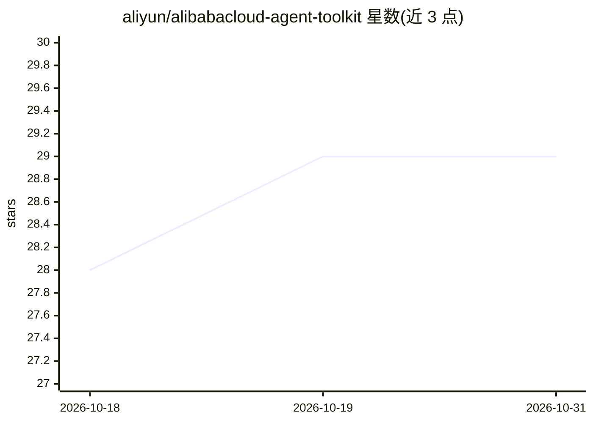

# aliyun/alibabacloud-agent-toolkit

⭐ 29 · Python · Apache-2.0 · 推送 2026-10-14 · [GitHub](https://github.com/aliyun/alibabacloud-agent-toolkit) · 组织维护 · 中文 README

**阿里云官方 AI 编码 agent 插件与 MCP 工具集**

阿里云官方仓库，为 AI 编码 agent 提供在阿里云上构建、部署、运维应用的插件、技能、MCP 配置与校验工具。含两个活跃插件：alibabacloud-core 通过受限 MCP server 生成阿里云 OpenAPI 交互代码；alibabacloud-spec-ops 提供规划→Terraform 代码生成→校验→经 IaC Service 执行的四阶段工作流。支持 Claude Code、Codex、QoderWork、VS Code 一键或手动安装。默认开启远程遥测，可通过环境变量关闭；本地 JSONL trace 支持自审计与可视化。

## 筛选速览

| 维度 | 判定 | 备注 |
|---|---|---|
| AI 角色 | `ai-ecosystem` | LLM/agent 周边工具 |
| 许可风险 | `permissive` | Apache-2.0 |
| 部署形态 | `library` | 以包/库形式分发 |
| 模型依赖 | — | README 未给出锁定关系 |
| 硬件要求 | — | 无带数字的原话,不猜 |
| 安装摩擦 | `low` | 无编译、无系统依赖或容器化 |
| 成熟度 | — | 结构信号不足 |

## 能力要点

- alibabacloud-core：经受限 MCP server 生成阿里云 OpenAPI 交互代码
- alibabacloud-spec-ops：规划→Terraform 代码生成→校验→IaC Service 执行的四阶段流程
- 支持 Claude Code / Codex / QoderWork / VS Code 四类客户端，npx openplugin 一键安装
- 本地 JSONL 审计 trace 与 telemetry-view 本地可视化（Gantt/链路图）

## 适用场景

- 让编码 agent 直接生成阿里云 OpenAPI 调用代码
- 用自然语言驱动阿里云基础设施的规划与 Terraform 部署
- 审计和排查 agent 在阿里云上的工具调用行为

## 场景标签

`代码生成` `工作流自动化` · 领域:效率与自动化

## 证据(README 行号)

> L7: Help AI coding agents build, deploy, and operate applications on Alibaba Cloud.
> L9: This repository provides Alibaba Cloud agent plugins, skills, MCP configuration, and validation tooling.
> L44: |alibabacloud-core|Active|Alibaba Cloud OpenAPI SDK code generation using the local `alibabacloud-core` MCP server.

## 星数曲线

2026-10-18 28 → 2026-10-31 29（+1）

---
*卡片 v1 · prompt 1.4 · 生成 2026-10-26 · 置信度 high · 依据 README sha `5625cc39df65` · [字段定义](../../DATASET.md)*
