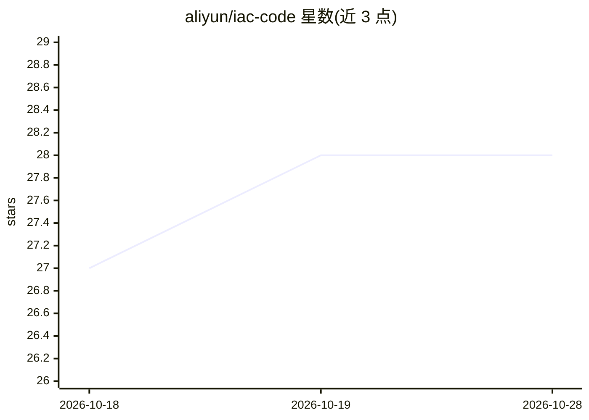

# aliyun/iac-code

⭐ 28 · Python · Apache-2.0 · 推送 2026-10-27 · [GitHub](https://github.com/aliyun/iac-code) · [官网](https://aliyun.github.io/iac-code/) · 组织维护 · 中文 README

**阿里云基础设施即代码 AI 助手：自然语言生成与部署 ROS/Terraform**

面向阿里云用户的 IaC 助手，通过自然语言交互规划云架构、编写 ROS 与 Terraform 模板、估算成本、操作资源栈并部署云资源。提供三种形态：无需 Python 环境的桌面应用（macOS/Windows/Linux 安装包）、Python 3.10+ 的 CLI（交互式 REPL、一次性 prompt、stdin）与本地 Web 应用（pip 安装 http extra 后启动，仅回环地址访问）。首次使用需在 /auth 中配置 LLM 提供商与云服务凭证；Windows 需要 Git Bash。另提供可接入兼容 agent 的 Agent Skill 包。

## 筛选速览

| 维度 | 判定 | 备注 |
|---|---|---|
| AI 角色 | `ai-native` | 本体是模型或模型工具 |
| 许可风险 | `permissive` | Apache-2.0 |
| 部署形态 | `desktop` | 安装包/桌面程序 |
| 模型依赖 | — | README 未给出锁定关系 |
| 硬件要求 | — | 无带数字的原话,不猜 |
| 安装摩擦 | `low` | 无编译、无系统依赖或容器化 |
| 成熟度 | — | 结构信号不足 |

## 能力要点

- 自然语言交互生成与部署 ROS/Terraform 模板
- 桌面应用（dmg/exe/AppImage/deb）与 CLI、Web 应用共享同一引擎与会话
- CLI 支持交互式 REPL、一次性 prompt 与 stdin 输入
- 提供可接入兼容 agent 的 Agent Skill 包

## 适用场景

- 用自然语言在阿里云创建 VPC、ECS、OSS 桶等资源
- 编写与操作 ROS 或 Terraform 模板并估算成本
- 在 agent 对话中规划与部署阿里云架构

## 场景标签

`AI 助手` `代码生成` · 领域:编码与开发

## 证据(README 行号)

> L3:  AI-powered Infrastructure as Code assistant for cloud infrastructure through natural language interaction. Currentl
> L88: Add IaC Code to a compatible agent to plan cloud architectures, work with ROS or Terraform templates, estimate cost

## 星数曲线

2026-10-18 27 → 2026-10-28 28（+1）

---
*卡片 v1 · prompt 1.4 · 生成 2026-10-26 · 置信度 high · 依据 README sha `68af46913c8c` · [字段定义](../../DATASET.md)*
