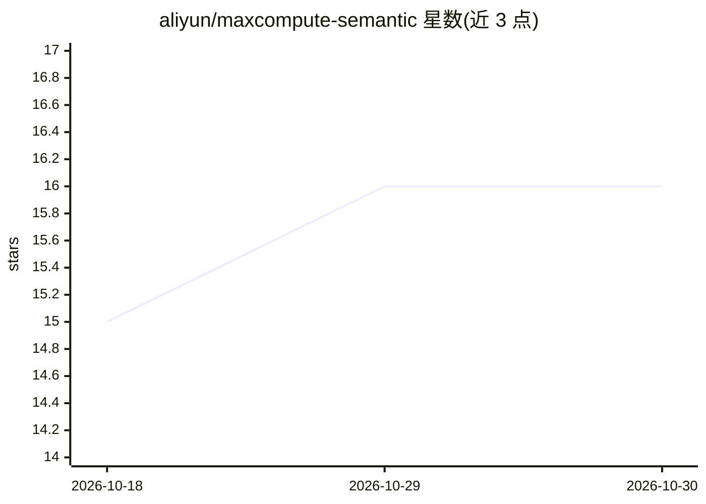

# aliyun/maxcompute-semantic

⭐ 16 · Python · Apache-2.0 · 推送 2026-10-26 · [GitHub](https://github.com/aliyun/maxcompute-semantic) · [官网](https://aliyun.github.io/maxcompute-semantic/) · 组织维护 · 中文 README

**为 AI agent 提供_MaxCompute 数据语义层与 SQL 护栏的 CLI**

面向使用 MaxCompute 数据仓库的 AI agent 场景：mcs build 扫描表元数据生成本地语义包（SQLite+markdown，含表/列描述、JOIN 关系、UDF、业务指标、已验证 SQL 与笔记），agent 写 SQL 前读取该包；执行前经 mcs sql review 方言检查、mcs sql cost 成本估算与写保护，再由 mcs sql execute 或异步生命周期执行。验证过的查询通过 BM25 记忆复用。以 Python CLI（uv/pip 安装）+ SKILL.md 技能包形式提供，支持 Claude Code、Cursor、Codex、Gemini CLI、Qwen Code 等平台接入；需自备_MaxCompute 项目与 SELECT 权限，配置与包均存本地。

## 筛选速览

| 维度 | 判定 | 备注 |
|---|---|---|
| AI 角色 | `ai-ecosystem` | LLM/agent 周边工具 |
| 许可风险 | `permissive` | Apache-2.0 |
| 部署形态 | `library` | 以包/库形式分发 |
| 模型依赖 | — | README 未给出锁定关系 |
| 硬件要求 | — | 无带数字的原话,不猜 |
| 安装摩擦 | `low` | 无编译、无系统依赖或容器化 |
| 成熟度 | — | 结构信号不足 |

## 能力要点

- mcs build 扫描元数据生成本地语义包（表/列/JOIN/UDF/指标）
- SQL 护栏：方言审查、成本估算、写保护、分层 schema 解析
- 验证 SQL 与笔记的 BM25 记忆复用
- 技能包支持 Claude Code、Cursor、Codex、Gemini CLI、Qwen Code 等平台

## 适用场景

- 让 AI agent 基于数仓元数据准确生成 MaxCompute SQL
- 查询执行前做成本估算与安全审查
- 沉淀已验证 SQL 供相似问题复用

## 场景标签

`数据分析` · 领域:效率与自动化

## 证据(README 行号)

> L13: `mcs` is a CLI for building a local semantic package from your MaxCompute
> L36: - **Agent integration** - the packaged skill works with Claude Code, Cursor,

## 星数曲线

2026-10-18 15 → 2026-10-30 16（+1）

---
*卡片 v1 · prompt 1.4 · 生成 2026-10-30 · 置信度 high · 依据 README sha `f2c221ee9f0b` · [字段定义](../../DATASET.md)*
