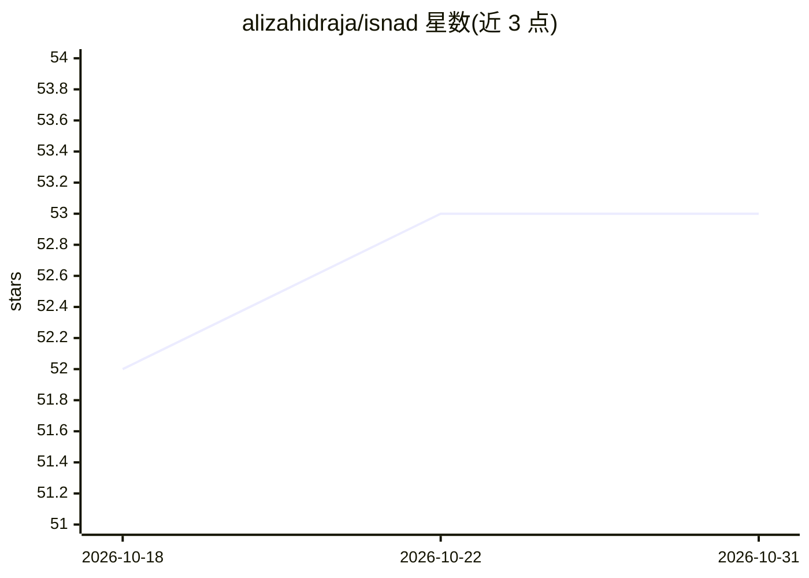

# alizahidraja/isnad

⭐ 53 · Python · Apache-2.0 · 推送 2026-10-27 · [GitHub](https://github.com/alizahidraja/isnad) · [官网](http://isnadhq.com) · 个人维护

**为 RAG 与多智能体系统提供来源链评级与审计记录的 Python 库**

Python 库（Apache-2.0，pip 安装），将圣训传述链科学（isnād–rijāl）适配到 LLM 管线：为声明经过的每个传递者（抓取器、agent、模型）登记等级，按最弱环节规则计算整链信任等级，结合内容批评输出 serve/review/quarantine 决策，并以 SHA-256 哈希、分离签名与 Merkle 日志生成防篡改审计记录，映射到 EU AI Act、ISO/IEC 42001、NIST AI RMF。提供 LangChain 回调集成与 JS/TS 验证器（npm）。README 公布验证状态表：部分组件（链级接地、内容批评）标注为 Partial，服务索引为单节点内存实现，不支持多 worker 高可用。

## 筛选速览

| 维度 | 判定 | 备注 |
|---|---|---|
| AI 角色 | `ai-ecosystem` | LLM/agent 周边工具 |
| 许可风险 | `permissive` | Apache-2.0 |
| 部署形态 | `library` | 以包/库形式分发 |
| 模型依赖 | — | README 未给出锁定关系 |
| 硬件要求 | — | 无带数字的原话,不猜 |
| 安装摩擦 | `low` | 无编译、无系统依赖或容器化 |
| 成熟度 | `idea` | |

## 能力要点

- 最弱环节（weakest-link）链级信任评级与 quarantine 门控
- SHA-256 + 分离签名 + Merkle 日志的防篡改审计记录，映射 EU AI Act / ISO 42001 / NIST AI RMF
- 在 575,060 条已评级链上与规则化评级约定测得 Cohen's κ = 0.871
- LangChain 回调/追踪集成与 npm 安装的 JS/TS 审计记录验证器

## 适用场景

- RAG / 多 agent 管线中追踪并评级每条声明的传递者
- 为监管合规审计导出可验证的信任评级证据
- 按链级信任等级决定声明是放行、人工复核还是隔离

## 场景标签

`LLM 可观测性` `模型评测` · 领域:评测与运维

## 证据(README 行号)

> L7: **Open-source** `pip install isnad` — **LLM provenance**, **agent trust**, and an
> L48: In a RAG pipeline or multi-agent system, a factual claim passes through many
> L53: tamper-detecting audit record for governance review.

## 星数曲线

2026-10-18 52 → 2026-10-31 53（+1）

---
*卡片 v1 · prompt 1.4 · 生成 2026-10-24 · 置信度 high · 依据 README sha `222b5abb81b0` · [字段定义](../../DATASET.md)*
