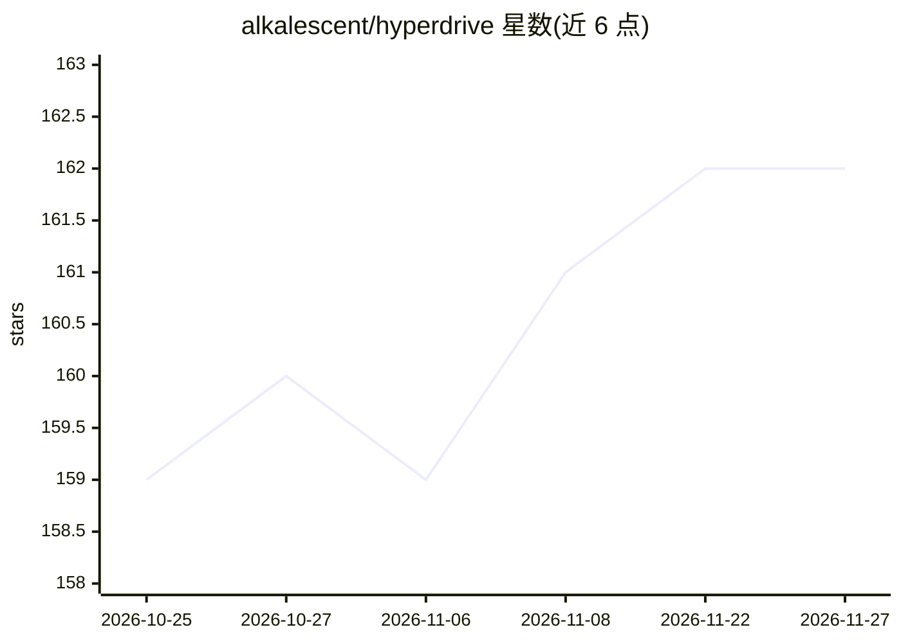

# alkalescent/hyperdrive

⭐ 162 · Python · MIT · 推送 2026-11-25 · [GitHub](https://github.com/alkalescent/hyperdrive) · [官网](https://Algotrade.io) · 个人维护

**面向量化研究者的机器学习算法交易库**

驱动量化研究机构 Algotrade.io 的算法交易 Python 库，专注数据采集与量化研究：从 Polygon、Robinhood、美国劳工统计局聚合市场数据，经 S3 存储历史数据，用 vectorbt 回测策略，通过 AutoGluon 做机器学习预测，并在 Binance、Alpaca、Kraken 下单执行。密钥通过环境变量传入；GitHub Actions 工作流支持数据自动更新；部分建模代码为闭源。MIT 许可，需 Python 3.11+。

## 筛选速览

| 维度 | 判定 | 备注 |
|---|---|---|
| AI 角色 | `ai-native` | 本体是模型或模型工具 |
| 许可风险 | `permissive` | MIT |
| 部署形态 | `library` | 以包/库形式分发 |
| 模型依赖 | — | README 未给出锁定关系 |
| 硬件要求 | — | 无带数字的原话,不猜 |
| 安装摩擦 | `medium` | 含编译或系统依赖之一 |
| 成熟度 | — | 结构信号不足 |

## 能力要点

- 聚合 Polygon、Robinhood、BLS 市场数据并存入 S3
- 基于 AutoGluon 的机器学习预测
- 用 vectorbt 回测策略
- 支持 Binance、Alpaca、Kraken 交易所下单

## 适用场景

- 采集并存储股票历史行情数据
- 用机器学习模型生成交易预测
- 对策略进行向量化回测
- 在加密货币交易所程序化下单

## 场景标签

`金融量化` · 领域:学习与行业

## 证据(README 行号)

> L13: **_hyperdrive_** is an algorithmic trading library that powers quant research firm **Algotrade.io**.
> L22: - **AI/ML**: Machine learning predictions with AutoGluon

## 星数曲线

2026-10-25 159 → 2026-11-27 162（+3）

---
*卡片 v1 · prompt 1.4 · 生成 2026-11-27 · 置信度 high · 依据 README sha `501025c2ec8a` · [字段定义](../../DATASET.md)*
