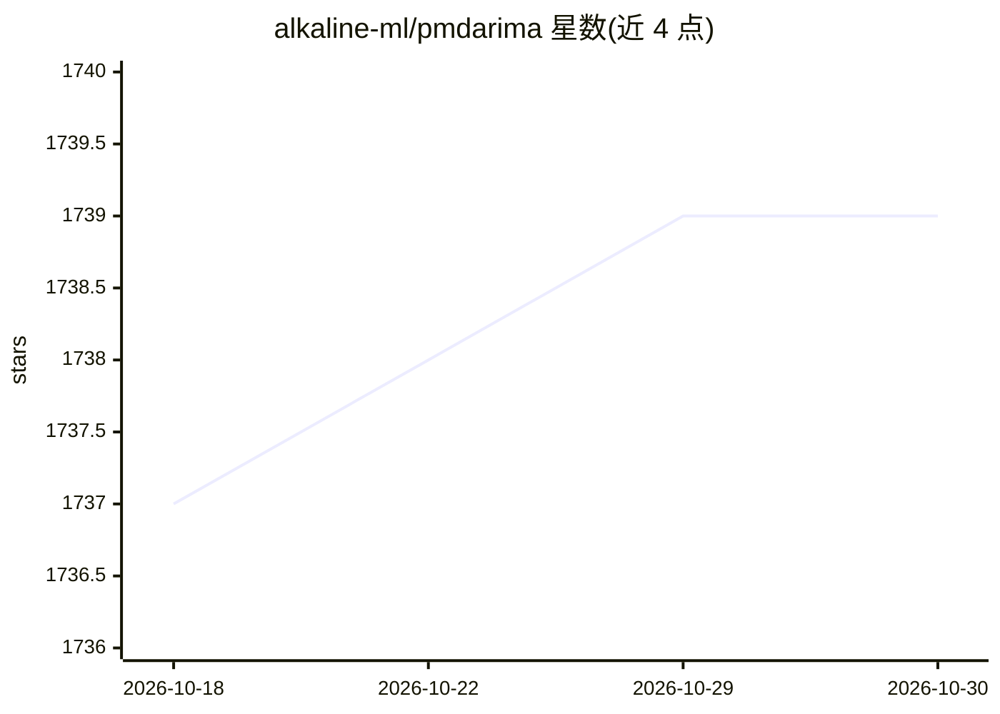

# alkaline-ml/pmdarima

⭐ 1,739 · Python · MIT · 推送 2026-10-19 · [GitHub](https://github.com/alkaline-ml/pmdarima) · [官网](https://www.alkaline-ml.com/pmdarima) · 组织维护

**Python 时间序列统计库：提供 R auto.arima 等价功能与 ARIMA 建模**

原名 pyramid-arima 的 Python 统计库，封装 statsmodels，接口风格面向 scikit-learn 用户。提供 R auto.arima 的等价功能、平稳性/季节性统计检验、差分与逆差分工具、Box-Cox 与 Fourier 变换、季节性分解、交叉验证工具、内置时间序列数据集与类 scikit-learn 的 Pipeline。通过 pip（Windows/Mac/Linux 预编译 wheel）与 conda-forge 渠道安装，源码构建需 cython 与 gcc/MinGW。

## 筛选速览

| 维度 | 判定 | 备注 |
|---|---|---|
| AI 角色 | `ai-native` | 本体是模型或模型工具 |
| 许可风险 | `permissive` | MIT |
| 部署形态 | `library` | 以包/库形式分发 |
| 模型依赖 | — | README 未给出锁定关系 |
| 硬件要求 | — | 无带数字的原话,不猜 |
| 安装摩擦 | `low` | 无编译、无系统依赖或容器化 |
| 成熟度 | — | 结构信号不足 |

## 能力要点

- R auto.arima 等价的自动 ARIMA 建模
- 平稳性/季节性统计检验与季节性分解
- Box-Cox、Fourier 等内外生变量变换器
- 类 scikit-learn Pipeline 与交叉验证工具，含内置数据集

## 适用场景

- 用 Python 自动拟合 ARIMA/SARIMAX 做时间序列预测
- 做时间序列平稳性检验、差分与季节性分解
- 用 Pipeline 组织估计器并序列化模型投入生产

## 场景标签

 · 领域:时间序列分析/统计建模

## 证据(README 行号)

> L11: Pmdarima (originally `pyramid-arima`, for the anagram of 'py' + 'arima') is a statistical
> L14:  * The equivalent of R's `auto.arima` functionality
> L23: Pmdarima wraps statsmodels

## 星数曲线

2026-10-18 1,737 → 2026-10-30 1,739（+2）

---
*卡片 v1 · prompt 1.4 · 生成 2026-10-21 · 置信度 high · 依据 README sha `5ea212e1270c` · [字段定义](../../DATASET.md)*
