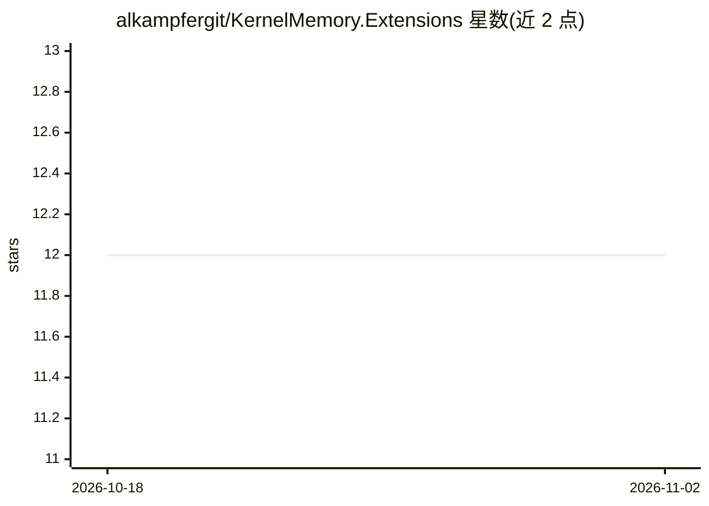

# alkampfergit/KernelMemory.Extensions

⭐ 12 · C# · MIT · 推送 2025-11-25 · [GitHub](https://github.com/alkampfergit/KernelMemory.Extensions) · 个人维护

**扩展 Microsoft Kernel Memory 的 RAG 搜索管道库**

面向 Microsoft Kernel Memory 的非官方扩展库，作者为自身其他项目需求构建。核心提供可自定义的搜索管道（Search Pipeline）实现，允许用户在检索阶段叠加多种技术以改进搜索结果。以 .NET/NuGet 包形式分发，README 含 SonarCloud 质量徽章。README 未列出具体安装命令或管道内可用的具体技术细节。

## 筛选速览

| 维度 | 判定 | 备注 |
|---|---|---|
| AI 角色 | `ai-ecosystem` | LLM/agent 周边工具 |
| 许可风险 | `permissive` | MIT |
| 部署形态 | `None` |  |
| 模型依赖 | — | README 未给出锁定关系 |
| 硬件要求 | — | 无带数字的原话,不猜 |
| 安装摩擦 | `low` | 无编译、无系统依赖或容器化 |
| 成熟度 | — | 结构信号不足 |

## 能力要点

- 提供与默认不同的搜索管道实现，支持用户插入多种检索技术
- 基于 Microsoft Kernel Memory 构建，扩展其基础功能

## 适用场景

- 基于 Kernel Memory 的 RAG 系统中自定义检索管道
- 在检索阶段组合多种搜索技术的 .NET 项目

## 场景标签

`RAG` · 领域:知识与检索

## 证据(README 行号)

> L3: In this project there are opinionated extensions to Microsoft Kernel Memory to extend basic functionalities of the l
> L7: It is a different implementation of the search pipeline that allows the user to setup a **real search pipeline where

## 星数曲线

2026-10-18 12 → 2026-11-02 12（+0）

---
*卡片 v1 · prompt 1.4 · 生成 2026-11-01 · 置信度 high · 依据 README sha `d07129ecf70e` · [字段定义](../../DATASET.md)*
