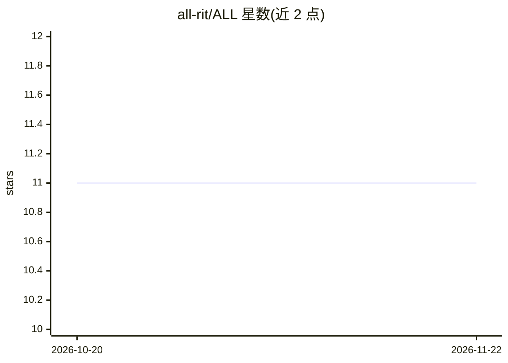

# all-rit/ALL

⭐ 11 · JavaScript · MIT · 推送 2026-11-20 · [GitHub](https://github.com/all-rit/ALL) · [官网](https://all.rit.edu) · 组织维护

**面向计算可访问性教育的自包含在线实验平台**

RIT 在 NSF 资助（Grant #1825023）下维护的 Accessible Learning Labs 项目，提供关于无障碍与公平软件的自包含 Web 实验课程。技术栈为 React 客户端、NodeJS 服务器与 PostgreSQL 数据库，客户端已从 CRA 迁移到 Vite；全栈通过 Docker Compose 在 .devcontainer 中运行，数据库无持久卷，种子数据通过容器内 npm run db:seed 应用。仓库要求 NodeJS v20.11.0 与 NPM 10.2.4，配置 ESLint 与 pre-commit 钩子，官网为 all.rit.edu。

## 筛选速览

| 维度 | 判定 | 备注 |
|---|---|---|
| AI 角色 | `ai-knowledge` | 知识聚合/清单类 |
| 许可风险 | `permissive` | MIT |
| 部署形态 | `self-host` | docker 或自建部署 |
| 模型依赖 | — | README 未给出锁定关系 |
| 硬件要求 | — | 无带数字的原话,不猜 |
| 安装摩擦 | `low` | 无编译、无系统依赖或容器化 |
| 成熟度 | — | 结构信号不足 |

## 能力要点

- 自包含 Web 实验课程，聚焦无障碍与公平软件
- 客户端/服务器/数据库全栈经 Docker Compose 一键运行
- Vite + React 客户端，配置 HMR/Fast Refresh 轮询监听
- NSF 资助的可计算可访问性教育项目

## 适用场景

- 在计算可访问性课程中让学生在线完成实验
- 查阅无障碍软件开发相关的教学实验内容
- 作为教学项目参考 Docker 全栈开发环境搭建

## 场景标签

`教程课程` · 领域:学习与行业

## 证据(README 行号)

> L1: # Accessible Learning Labs
> L22: The full stack (client, server, and database) runs in Docker via `.devcontainer/docker-compose.yml`. This replaces
> L79: ## Part of The National Science Foundation's Grant for Developing Experiential Laboratories for Computing Accessibi

## 星数曲线

2026-10-20 11 → 2026-11-22 11（+0）

---
*卡片 v1 · prompt 1.4 · 生成 2026-11-18 · 置信度 mid · 依据 README sha `b626ca34448f` · [字段定义](../../DATASET.md)*
