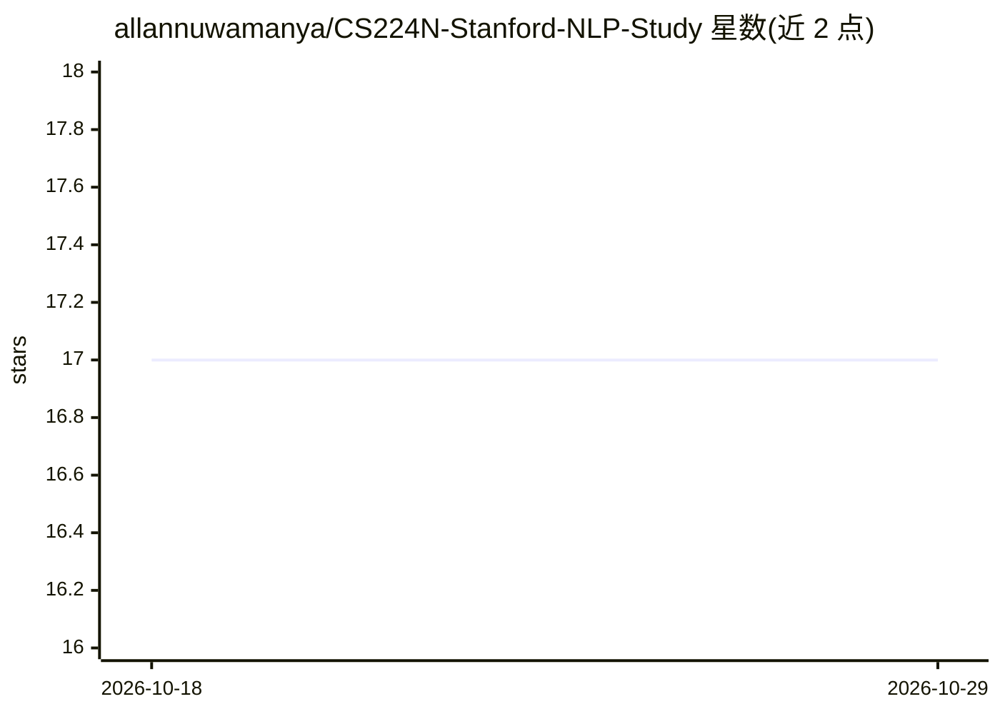

# allannuwamanya/CS224N-Stanford-NLP-Study

⭐ 17 · Python · MIT · 推送 2026-07-09 · [GitHub](https://github.com/allannuwamanya/CS224N-Stanford-NLP-Study) · [官网](https://web.stanford.edu/class/archive/cs/cs224n/cs224n.1194/index.html#schedule) · 个人维护

**Stanford CS224N 课程学习资料库：讲义、作业解答与复现环境**

面向学习者的 Stanford CS224N（深度学习自然语言处理）学习资料仓库：收录 19 讲的讲义幻灯片、5 次作业的代码与书面解答（涵盖词向量、Word2Vec、依存句法分析、seq2seq 神经机器翻译、Transformer 与自监督学习），并附 Conda、pip+venv、VS Code Devcontainer 三种可复现环境搭建方式，以及 8 周学习计划与阅读论文清单。作业解答部分基于 Florian Kark 的解答改编，基础设施文件改编自 suous/cs224n。

## 筛选速览

| 维度 | 判定 | 备注 |
|---|---|---|
| AI 角色 | `ai-knowledge` | 知识聚合/清单类 |
| 许可风险 | `permissive` | MIT |
| 部署形态 | `library` | 以包/库形式分发 |
| 模型依赖 | — | README 未给出锁定关系 |
| 硬件要求 | — | 无带数字的原话,不猜 |
| 安装摩擦 | `low` | 无编译、无系统依赖或容器化 |
| 成熟度 | — | 结构信号不足 |

## 能力要点

- 19 讲讲义幻灯片与课程资源整理
- 5 次作业的代码与书面解答（词向量到 Transformer）
- Conda / pip+venv / Devcontainer 三种可复现环境配置
- 8 周学习计划与配套论文阅读清单

## 适用场景

- 跟随 CS224N 系统学习 NLP 与深度学习
- 对照作业解答核对与复习课程作业
- 用预配置环境快速搭建课程实验环境

## 场景标签

`教程课程` · 领域:学习与行业

## 证据(README 行号)

> L10: A comprehensive study companion for Stanford's CS224N: Natural Language Processing with Deep Learning (Winter 2023)
> L12: This repository contains lecture slides, completed assignment solutions (code + written), and infrastructure for a 

## 星数曲线

2026-10-18 17 → 2026-10-29 17（+0）

---
*卡片 v1 · prompt 1.4 · 生成 2026-10-29 · 置信度 high · 依据 README sha `59dcf72e1614` · [字段定义](../../DATASET.md)*
