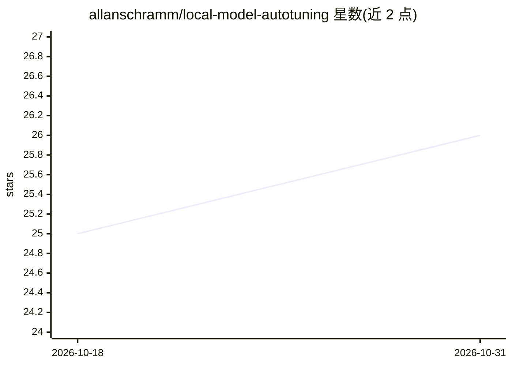

# allanschramm/local-model-autotuning

⭐ 26 · Python · 推送 2026-10-30 · [GitHub](https://github.com/allanschramm/local-model-autotuning) · [官网](https://ailocal.com.br/) · 个人维护 · 中文 README

**llama.cpp 本地模型运行时参数的自动调优工具（爬山循环）**

面向本地 GGUF 模型使用者的运行时优化工具：通过 hill-climbing 循环自动测试大量 llama.cpp 运行时 flag 组合（KV cache、batching、threads、MTP），按吞吐与质量的 Pareto 前沿搜索最优服务配置，输出 results.tsv 与本地 config.py。附带只读 Dashboard、硬件诊断脚本与 6 节 HTML 课程。README 以显著篇幅声明硬件风险（OOM/BSOD/热应力），需 Python 3.11+ 与 llama.cpp 预编译 release，不含量化功能。

## 筛选速览

| 维度 | 判定 | 备注 |
|---|---|---|
| AI 角色 | `ai-ecosystem` | LLM/agent 周边工具 |
| 许可风险 | `none` | — |
| 部署形态 | `desktop` | 安装包/桌面程序 |
| 模型依赖 | local-ok | 支持本地模型 |
| 硬件要求 | — | 无带数字的原话,不猜 |
| 安装摩擦 | `high` | 编译与系统依赖俱全 |
| 成熟度 | — | 结构信号不足 |

## 能力要点

- hill-climbing 循环自动搜索 llama.cpp 运行时 flag 最优组合
- 四轴 Pareto 评估（ctx × TPS × agentic × coding），含 TPS Floor 机制
- 只读 Dashboard（http://127.0.0.1:18765）展示 Baseline 与 Trial 日志
- 硬件诊断与服务器验证脚本（check_hardware.py / verify_setup.py）

## 适用场景

- 为本地 GGUF 模型找到速度与质量兼顾的 llama.cpp 服务配置
- 测试不同运行时 flag 对吞吐的影响并留存结果
- 按课程路径学习本地 LLM 部署与调优

## 场景标签

`教程课程` · 领域:学习与行业

## 证据(README 行号)

> L3: Otimizador autônomo (hill-climbing) de flags de runtime de LLMs locais via `llama.cpp`. Baseado em karpathy/autorese
> L5: **O que faz:** Encontra a config de runtime mais rápida e precisa pro seu modelo GGUF local, testando milhares de co
> L145: 1. Lê o Baseline atual de `autoresearch/core/config.py`

## 星数曲线

2026-10-18 25 → 2026-10-31 26（+1）

---
*卡片 v1 · prompt 1.4 · 生成 2026-10-27 · 置信度 mid · 依据 README sha `217136c3cd83` · [字段定义](../../DATASET.md)*
