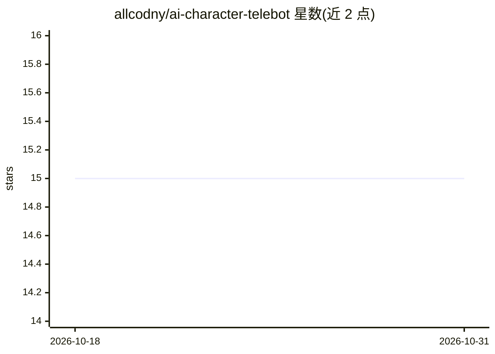

# allcodny/ai-character-telebot

⭐ 15 · Python · MIT · 推送 2026-07-16 · [GitHub](https://github.com/allcodny/ai-character-telebot) · 个人维护

**以指定角色人设在 Telegram 中回复消息的 AI 机器人**

基于 Python 的 Telegram 机器人，通过 OpenRouter API 调用大模型，按用户在 prompts.py 中定义的角色人设生成回复。支持私聊、群聊与帖子评论场景，具备图像识别、上下文理解、按用户差异化回应、可配置回复频率与白名单安全机制。安装方式为克隆仓库后 pip 安装依赖、配置 bot_config.py 与 prompts.py 再运行 bot.py；需自备 Telegram bot token 与 OpenRouter API key，并建议部署在持续运行的主机上。免费模型有每分钟/每日请求次数限制。

## 筛选速览

| 维度 | 判定 | 备注 |
|---|---|---|
| AI 角色 | `ai-native` | 本体是模型或模型工具 |
| 许可风险 | `permissive` | MIT |
| 部署形态 | `library` | 以包/库形式分发 |
| 模型依赖 | locked-api |  |
| 硬件要求 | — | 无带数字的原话,不猜 |
| 安装摩擦 | `low` | 无编译、无系统依赖或容器化 |
| 成熟度 | — | 结构信号不足 |

## 能力要点

- 按 prompts.py 中定义的角色人设生成回复
- 支持私聊/群聊/评论多场景，图像识别与上下文理解
- 可配置回复频率与白名单（安全与请求量控制）
- 通过 OpenRouter 可更换任意模型

## 适用场景

- 让 bot 以我设定的角色在群里聊天或评论区留言
- 运营一个有人设的 Telegram 私聊机器人
- 通过白名单控制 bot 的使用范围与请求开销

## 场景标签

`聊天机器人` · 领域:对话与助手

## 证据(README 行号)

> L6: A Telegram bot with AI integration (via OpenRouter) for generating text responses in the persona of any character.
> L9: * Generating meaningful responses according to the character's personality defined in your prompt

## 星数曲线

2026-10-18 15 → 2026-10-31 15（+0）

---
*卡片 v1 · prompt 1.4 · 生成 2026-10-30 · 置信度 mid · 依据 README sha `2fdb978f88b7` · [字段定义](../../DATASET.md)*
