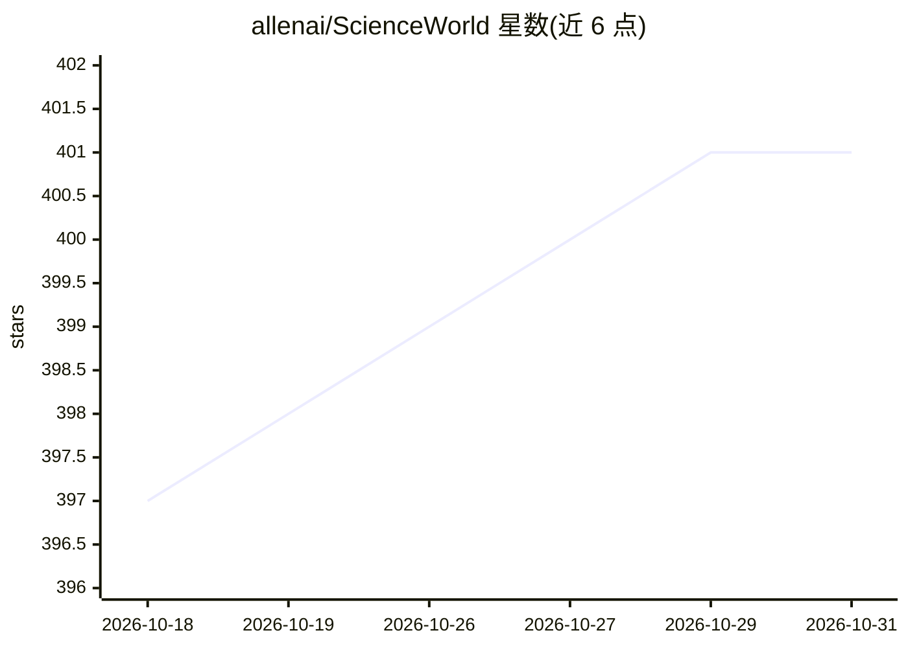

# allenai/ScienceWorld

⭐ 401 · Scala · Apache-2.0 · 推送 2026-08-20 · [GitHub](https://github.com/allenai/ScienceWorld) · [官网](https://sciworld.apps.allenai.org/) · 组织维护

**面向小学科学课程任务的文本虚拟环境，供智能体研究与评测**

ScienceWorld 是围绕标准化小学科学课程任务构建的文本交互虚拟环境，随论文发布。核心用 Scala(2.12.9) 编写、编译为 JAR 由 Java 运行，经 py4j 提供 Python API(>=3.8)。环境包含 30 个任务（沸腾、融化、导电性测量、遗传学等）及大量变体，支持 teleportAction、openDoors 等简化选项降低学习难度，并给出 DRRN、KG-A2C、CALM 等基线智能体链接。给强化学习/文本智能体研究者使用；运行需 Java 1.8+。

## 筛选速览

| 维度 | 判定 | 备注 |
|---|---|---|
| AI 角色 | `ai-ecosystem` | LLM/agent 周边工具 |
| 许可风险 | `permissive` | Apache-2.0 |
| 部署形态 | `library` | 以包/库形式分发 |
| 模型依赖 | — | README 未给出锁定关系 |
| 硬件要求 | — | 无带数字的原话,不猜 |
| 安装摩擦 | `medium` | 含编译或系统依赖之一 |
| 成熟度 | — | 结构信号不足 |

## 能力要点

- 30 个科学任务及最多上千变体的文本环境
- py4j 桥接的 Python API 与 Scala/JVM 模拟器
- teleportAction/openDoors 等简化预设便于智能体学习
- 提供 web server 浏览器交互演示与多个基线智能体链接

## 适用场景

- 在标准化科学任务上训练与评测文本智能体
- 用随机智能体或人工控制台探索环境行为
- 通过简化预设调节任务难度做消融实验

## 场景标签

`模型评测` `强化学习` · 领域:评测与运维

## 证据(README 行号)

> L15: ScienceWorld is a text-based virtual environment centered around accomplishing tasks from the standardized elementa
> L140: # Baseline Agents

## 星数曲线

2026-10-18 397 → 2026-10-31 401（+4）

---
*卡片 v1 · prompt 1.4 · 生成 2026-10-21 · 置信度 high · 依据 README sha `0905da32cfbf` · [字段定义](../../DATASET.md)*
