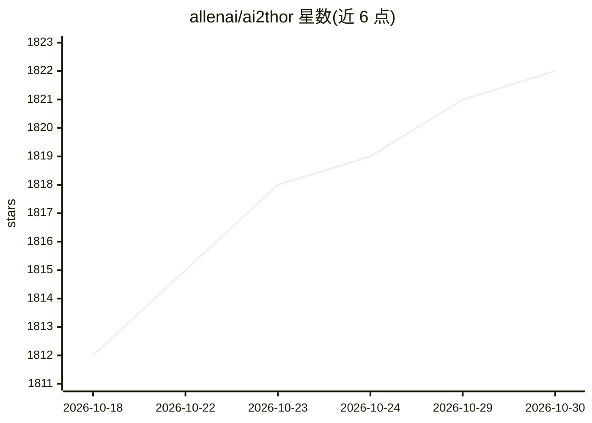

# allenai/ai2thor

⭐ 1,822 · C# · Apache-2.0 · 推送 2025-11-04 · [GitHub](https://github.com/allenai/ai2thor) · [官网](http://ai2thor.allenai.org) · 组织维护

**给具身智能研究者的交互式视觉仿真平台**

AI2-THOR 是基于 Unity 3D 的具身智能研究交互仿真平台，包含 iTHOR、ManipulaTHOR、RoboTHOR 三套环境，分别面向常识推理、机械臂视觉操作与 Sim2Real 研究。提供 200+ 场景、2600+ 可交互物体、200+ 动作及多种图像模态（RGB、实例/语义分割、深度、法线等），每步返回环境状态元数据。通过 pip/conda 安装，支持 Docker 与 Google Colab 运行；运行需 X server（Linux）与 DX9/DX11 级别显卡。

## 筛选速览

| 维度 | 判定 | 备注 |
|---|---|---|
| AI 角色 | `ai-ecosystem` | LLM/agent 周边工具 |
| 许可风险 | `permissive` | Apache-2.0 |
| 部署形态 | `library` | 以包/库形式分发 |
| 模型依赖 | — | README 未给出锁定关系 |
| 硬件要求 | — | 无带数字的原话,不猜 |
| 安装摩擦 | `low` | 无编译、无系统依赖或容器化 |
| 成熟度 | — | 结构信号不足 |

## 能力要点

- iTHOR/ManipulaTHOR/RoboTHOR 三套具身智能交互环境
- 200+ 场景与 2600+ 带标注的可交互物体，支持物理交互
- 多图像模态：RGB、实例/语义分割、深度、法线、俯视图等
- 每步返回环境元数据，可构建自定义奖励函数

## 适用场景

- 在仿真场景中训练与评测具身智能体的导航和交互能力
- 做视觉机械臂操作与 Sim2Real 迁移研究
- 用多种图像模态开展视觉感知实验

## 场景标签

 · 领域:具身智能/仿真平台

## 证据(README 行号)

> L1: A Near Photo-Realistic Interactable Framework for Embodied AI Agents
> L33:  A high-level interaction framework that facilitates research in embodied common sense reasoning.
> L35:  A mid-level interaction framework that facilitates visual manipulation of objects using a robotic arm.

## 星数曲线

2026-10-18 1,812 → 2026-10-30 1,822（+10）

---
*卡片 v1 · prompt 1.4 · 生成 2026-10-21 · 置信度 high · 依据 README sha `863c49165ef6` · [字段定义](../../DATASET.md)*
