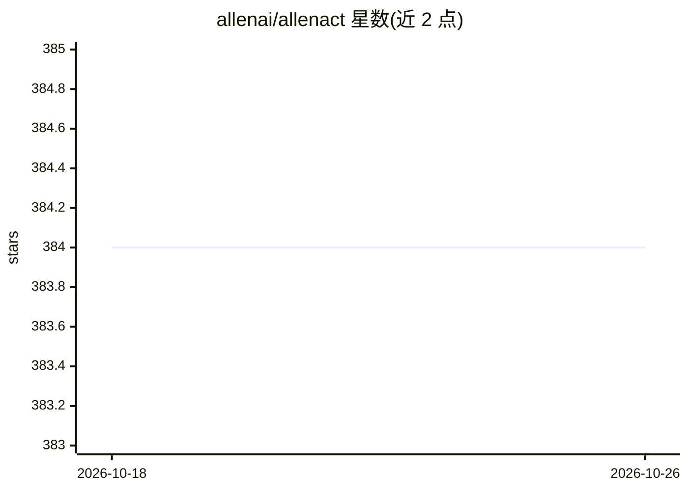

# allenai/allenact

⭐ 384 · Python · NOASSERTION · 推送 2026-05-19 · [GitHub](https://github.com/allenai/allenact) · [官网](https://www.allenact.org) · 组织维护

**面向具身 AI 研究的模块化强化学习框架**

由 Allen Institute for AI (AI2) PRIOR 团组维护的开源具身 AI（Embodied-AI）研究框架。支持 iTHOR、RoboTHOR、Habitat、MiniGrid、OpenAI Gym 等环境，将任务与环境解耦；提供 A2C、PPO、DD-PPO、DAgger、离线模仿学习等算法，支持多智能体、多重损失组合、Tensorboard 可视化与预训练模型。以 PyTorch 为目标框架，面向强化学习与具身智能研究人员，MIT 许可。

## 筛选速览

| 维度 | 判定 | 备注 |
|---|---|---|
| AI 角色 | `ai-ecosystem` | LLM/agent 周边工具 |
| 许可风险 | `permissive` | NOASSERTION |
| 部署形态 | `None` |  |
| 模型依赖 | — | README 未给出锁定关系 |
| 硬件要求 | — | 无带数字的原话,不猜 |
| 安装摩擦 | `low` | 无编译、无系统依赖或容器化 |
| 成熟度 | — | 结构信号不足 |

## 能力要点

- 支持 iTHOR/RoboTHOR/Habitat/MiniGrid/Gym 多种具身环境
- 任务与环境解耦的抽象设计，支持离散与连续动作空间
- PPO/DD-PPO/A2C/DAgger/离线 IL 等算法与多智能体支持
- 提供教程、启动代码、预训练模型与 Tensorboard 可视化

## 适用场景

- 在多种具身环境中做强化学习实验与算法复现
- 研究 PointNav/ObjectNav 等具身导航任务
- 基于预训练模型与教程入门具身 AI 研究

## 场景标签

`强化学习` `科研工具` · 领域:学习与行业

## 证据(README 行号)

> L1: An open source framework for research in Embodied AI
> L12: **AllenAct** is a modular and flexible learning framework designed with a focus on the unique requirements of Embod
> L29: * _Algorithms_: Support for a variety of on-policy algorithms including PPO, DD-PPO, A2C, Imitation Learning and DA

## 星数曲线

2026-10-18 384 → 2026-10-26 384（+0）

---
*卡片 v1 · prompt 1.4 · 生成 2026-10-21 · 置信度 high · 依据 README sha `aeb0d0bfef4c` · [字段定义](../../DATASET.md)*
