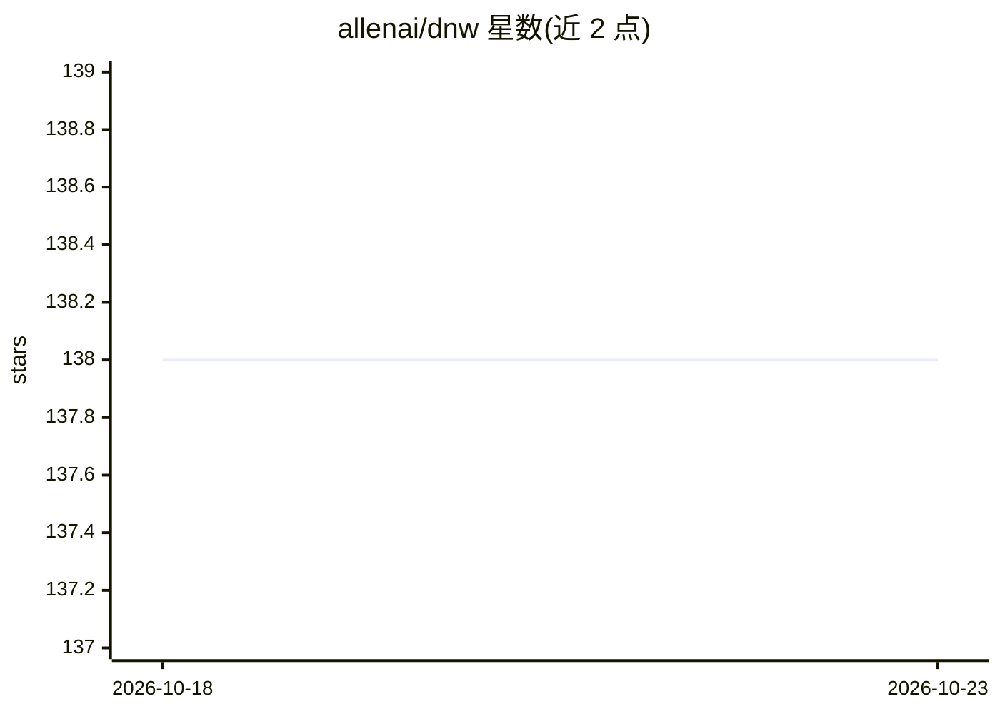

# allenai/dnw

⭐ 138 · Python · NOASSERTION · 推送 2026-03-05 · [GitHub](https://github.com/allenai/dnw) · 组织维护

**论文官方代码：训练中同时学习网络结构与参数（DNW）**

Discovering Neural Wirings 的官方实现：放宽传统层结构，允许通道独立形成连接，在训练网络参数的同时学习网络结构本身。提供 CIFAR-10 小规模实验（41k 参数分类器）、ImageNet 大规模实验与预训练模型评估（含 MobileNet V1 / ShuffleNet V2 对比结果），以及 one-shot 剪枝等其他结构发现方法。基于 Python 3.6 与 venv 安装 requirements，使用 runner.py 按实验文件运行，支持多 GPU；fast_eval 可移除死亡神经元加速推理，可选 DGL 图实现对齐理论 FLOPs。

## 筛选速览

| 维度 | 判定 | 备注 |
|---|---|---|
| AI 角色 | `ai-native` | 本体是模型或模型工具 |
| 许可风险 | `none` | NOASSERTION |
| 部署形态 | `library` | 以包/库形式分发 |
| 模型依赖 | — | README 未给出锁定关系 |
| 硬件要求 | — | 无带数字的原话,不猜 |
| 安装摩擦 | `medium` | 含编译或系统依赖之一 |
| 成熟度 | — | 结构信号不足 |

## 能力要点

- 训练中同时学习网络参数与连接结构
- 提供 CIFAR-10 静态/离散/连续时间实验与 ImageNet 实验文件
- 提供 ImageNet 预训练模型评估与 --fast_eval 剪除死亡神经元加速推理
- 可选 DGL 图实现使评估模型匹配理论 FLOPs

## 适用场景

- 复现 DNW 论文的 CIFAR-10 与 ImageNet 实验
- 评估论文提供的 ImageNet 预训练模型
- 研究神经网络结构搜索与稀疏网络训练方法

## 场景标签

 · 领域:机器学习/神经架构搜索

## 证据(README 行号)

> L7: In this work we propose a method for discovering neural wirings.
> L11: The wiring of our network is not fixed during training --

## 星数曲线

2026-10-18 138 → 2026-10-23 138（+0）

---
*卡片 v1 · prompt 1.4 · 生成 2026-10-22 · 置信度 mid · 依据 README sha `f86e15a4b37a` · [字段定义](../../DATASET.md)*
