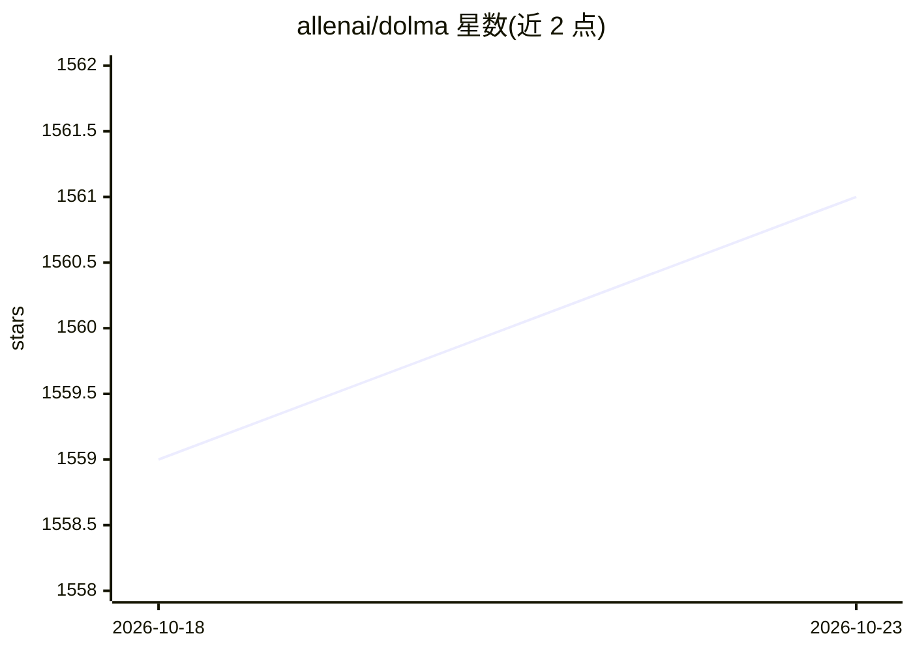

# allenai/dolma

⭐ 1,561 · Python · Apache-2.0 · 推送 2026-08-24 · [GitHub](https://github.com/allenai/dolma) · [官网](https://allenai.github.io/dolma/) · 组织维护

**给 NLP 研究者：3 万亿 token 开放预训练语料与数据清洗工具包**

Dolma 包含两部分：一是 3 万亿 token 的开放数据集，来源覆盖网页、学术出版物、代码、书籍与百科材料，作为 OLMo 语言模型的训练语料，托管于 HuggingFace Hub，采用 ODC-BY 许可；二是本仓库的 Dolma Toolkit，用于为（预）训练 ML 模型整理大规模数据集，特性包括内置并行处理数十亿文档、支持单机/集群/云环境、内置 Gopher/C4/OpenWebText 常用 tagger、基于 Rust Bloom filter 的去重，以及自定义 tagger 与 AWS S3 兼容位置支持。通过 pip 安装。

## 筛选速览

| 维度 | 判定 | 备注 |
|---|---|---|
| AI 角色 | `ai-ecosystem` | LLM/agent 周边工具 |
| 许可风险 | `permissive` | Apache-2.0 |
| 部署形态 | `library` | 以包/库形式分发 |
| 模型依赖 | — | README 未给出锁定关系 |
| 硬件要求 | — | 无带数字的原话,不猜 |
| 安装摩擦 | `low` | 无编译、无系统依赖或容器化 |
| 成熟度 | — | 结构信号不足 |

## 能力要点

- 3 万亿 token 开放数据集，OLMo 训练语料
- 内置并行处理数十亿文档，支持单机/集群/云
- 内置 Gopher、C4、OpenWebText 常用 tagger
- Rust Bloom filter 文档去重，支持 AWS S3 兼容位置

## 适用场景

- 为语言模型预训练构建和清洗大规模语料
- 下载现成的 3 万亿 token 语料用于训练研究
- 复现或扩展 Gopher/C4 风格的数据整理流程

## 场景标签

`MLOps` · 领域:训练与推理

## 证据(README 行号)

> L6: 2. **Dolma Toolkit**: a high-performance toolkit for curating datasets for language modeling -- this repo contains t
> L19: This repository houses the Dolma Toolkit, which enables curation of large datasets for (pre)-training ML models. It

## 星数曲线

2026-10-18 1,559 → 2026-10-23 1,561（+2）

---
*卡片 v1 · prompt 1.4 · 生成 2026-10-21 · 置信度 high · 依据 README sha `82978afdff87` · [字段定义](../../DATASET.md)*
