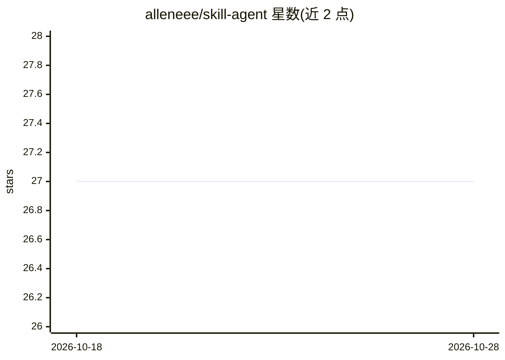

# alleneee/skill-agent

⭐ 27 · Python · 推送 2026-03-24 · [GitHub](https://github.com/alleneee/skill-agent) · 个人维护 · 中文 README

**基于 FastAPI 的多 Agent 框架：多 LLM 接入、工具执行与协作编排**

面向开发者的 AI Agent 系统框架（Omni Agent），基于 FastAPI 提供 RESTful API 与 SSE 流式输出。通过 LiteLLM 支持 100+ LLM 提供商并自动适配参数限制；提供文件/Bash/Skills 等工具执行、MCP 协议集成、SpawnAgent 子任务委派、Leader-Member 多 Agent 协作、MsgHub 事件通信、LangGraph 风格 Graph 工作流、PostgreSQL+pgvector 混合检索 RAG、基于 agent-sandbox 的 Docker 沙箱隔离，以及 Zed ACP 协议端点用于编辑器集成。使用 uv 安装依赖并配置 .env 运行；RAG、沙箱、ACP 等为可选配置。

## 筛选速览

| 维度 | 判定 | 备注 |
|---|---|---|
| AI 角色 | `ai-ecosystem` | LLM/agent 周边工具 |
| 许可风险 | `none` | — |
| 部署形态 | `self-host` | docker 或自建部署 |
| 模型依赖 | locked-api |  |
| 硬件要求 | — | 无带数字的原话,不猜 |
| 安装摩擦 | `low` | 无编译、无系统依赖或容器化 |
| 成熟度 | — | 结构信号不足 |

## 能力要点

- 通过 LiteLLM 统一接口支持 100+ LLM 提供商，自动标准化模型名与 max_tokens 适配
- SpawnAgent 子任务委派与 Leader-Member Team 多 Agent 协作（researcher/writer/coder 等角色）
- RAG 混合检索（hybrid/semantic/keyword），基于 PostgreSQL + pgvector
- 每个 Session 独立 Docker 沙箱，隔离执行不受信任代码
- 实现 Zed Agent Client Protocol，支持 Claude Code、Codex、Qwen 等多后端接入

## 适用场景

- 构建需要多步工具执行与人工确认的自动化 Agent 服务
- 编排多 Agent 协作完成研究、写作、编码等复合任务
- 通过 RAG 知识库为 Agent 提供私有文档检索能力
- 以 ACP 协议将 Agent 集成到 Zed 等代码编辑器

## 场景标签

`Agent 框架` `多智能体` · 领域:Agent 开发

## 证据(README 行号)

> L10: - **多模型支持**: 通过 LiteLLM 支持 100+ LLM 提供商，智能适配参数限制
> L21: - **MCP 集成**: 支持 Model Context Protocol，扩展外部工具能力
> L35: - **RAG 知识库**: 混合检索（语义+关键词），基于 PostgreSQL + pgvector

## 星数曲线

2026-10-18 27 → 2026-10-28 27（+0）

---
*卡片 v1 · prompt 1.4 · 生成 2026-10-26 · 置信度 mid · 依据 README sha `cc4ae5d033c9` · [字段定义](../../DATASET.md)*
