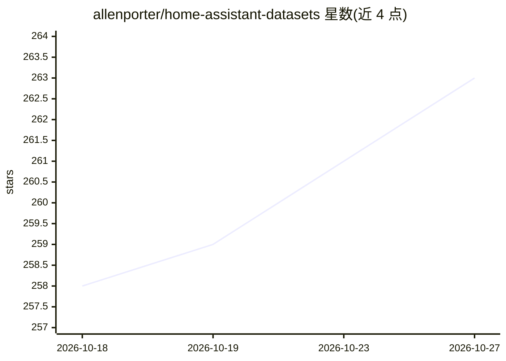

# allenporter/home-assistant-datasets

⭐ 263 · Jupyter Notebook · Apache-2.0 · 推送 2026-10-26 · [GitHub](https://github.com/allenporter/home-assistant-datasets) · [官网](https://allenporter.github.io/home-assistant-datasets) · 个人维护

**面向 Home Assistant 的 AI 模型评测数据集集合**

一套围绕 Home Assistant 场景评测 AI/LLM 模型的数据集与评测流程：用少量种子数据经 LLM 生成合成家庭数据，加载到 Home Assistant（Synthetic Home 格式）并驱动设备状态变化，配合对话 agent（OpenAI、Google、自定义组件等）收集模型输出，再以 pytest 运行评测或由人工标注打分，并可视化跟踪不同模型、prompt、工具、RAG 配置的效果变化。包含 assist/assist-mini/intents 语音动作数据集、自动化蓝图生成评测集和区域摘要人工评测集。面向智能助手开发者与模型评测人员。

## 筛选速览

| 维度 | 判定 | 备注 |
|---|---|---|
| AI 角色 | `ai-knowledge` | 知识聚合/清单类 |
| 许可风险 | `permissive` | Apache-2.0 |
| 部署形态 | `None` |  |
| 模型依赖 | — | README 未给出锁定关系 |
| 硬件要求 | — | 无带数字的原话,不猜 |
| 安装摩擦 | `low` | 无编译、无系统依赖或容器化 |
| 成熟度 | — | 结构信号不足 |

## 能力要点

- 合成家庭数据生成（LLM + 种子数据 + prompt）
- pytest + Synthetic Home + 任意对话 agent 的离线评测流程
- 含 assist/assist-mini/intents/automations 等多个数据集目录
- 人工标注（1-3 分）与 Doccano 流程支持

## 适用场景

- 评测不同 LLM 在智能家居语音指令上的动作正确性
- 测试模型生成自动化蓝图/蓝图代码的正确性
- 跟踪模型、prompt、工具、RAG 改进对效果的影响

## 场景标签

`模型评测` · 领域:评测与运维

## 证据(README 行号)

> L3: This package is a collection of datasets for evaluating AI Models in the context
> L8: - Collect Model Outputs: Run the datasets with Home Assistant Conversation agents with different models (e.g. OpenAI
> L9: - Evaluate Results: Evaluate the model outsputs with the groundtruth (e.g. is the action correct), or humans can ann

## 星数曲线

2026-10-18 258 → 2026-10-27 263（+5）

---
*卡片 v1 · prompt 1.4 · 生成 2026-10-22 · 置信度 high · 依据 README sha `25cb01457640` · [字段定义](../../DATASET.md)*
