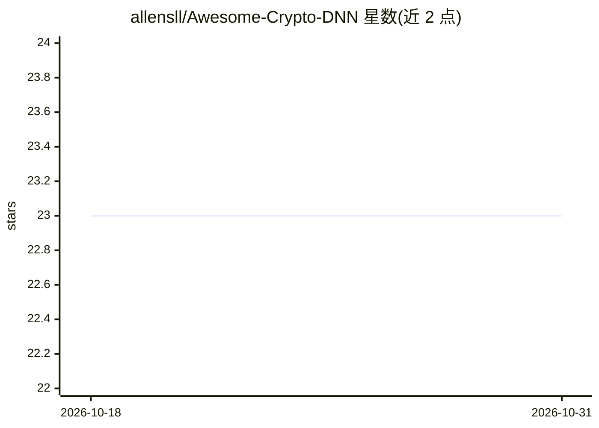

# allensll/Awesome-Crypto-DNN

⭐ 23 · 推送 2026-04-01 · [GitHub](https://github.com/allensll/Awesome-Crypto-DNN) · 个人维护

**密码学辅助深度学习隐私计算论文清单（2021-2025）**

由个人维护的论文聚合清单，收录密码学辅助深度学习隐私计算方向的会议论文，覆盖 NeurIPS/ICML/ICLR/ICCV/CCS/NDSS/USENIX Security/SP/PETS/ACL/ECCV/DAC 等会议 2021-2025 年条目，主题包括 MPC 与全同态加密下的安全推理、隐私保护 Transformer/GNN/CNN 推理与训练、密文下模型线性化与 ReLU 替换等。条目按年份分组，部分标注 code 代码链接。

## 筛选速览

| 维度 | 判定 | 备注 |
|---|---|---|
| AI 角色 | `ai-knowledge` | 知识聚合/清单类 |
| 许可风险 | `none` | — |
| 部署形态 | `None` |  |
| 模型依赖 | — | README 未给出锁定关系 |
| 硬件要求 | — | 无带数字的原话,不猜 |
| 安装摩擦 | `low` | 无编译、无系统依赖或容器化 |
| 成熟度 | — | 结构信号不足 |

## 能力要点

- 按年份组织（2021-2025）的会议论文清单
- 覆盖 FHE/MPC 下的安全推理与训练方向
- 部分条目附 code 代码标注

## 适用场景

- 查找隐私保护机器学习方向的论文
- 了解安全推理（Transformer/GNN/CNN）研究脉络
- 按会议和时间定位相关代码实现

## 场景标签

`精选清单` · 领域:学习与行业

## 证据(README 行号)

> L1: # Awesome-Crypto-DNN
> L3: - MPCache: MPC-Friendly KV Cache Eviction for Efficient Private LLM Inference, Wenxuan Zeng, Wenxuan_Zeng, Ye Dong, 

## 星数曲线

2026-10-18 23 → 2026-10-31 23（+0）

---
*卡片 v1 · prompt 1.4 · 生成 2026-10-27 · 置信度 high · 依据 README sha `c66ef021ae4d` · [字段定义](../../DATASET.md)*
