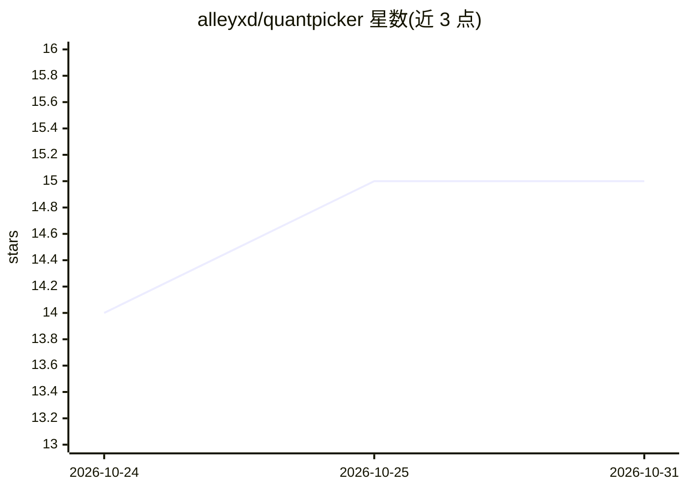

# alleyxd/quantpicker

⭐ 15 · Rust · MIT · 推送 2026-10-28 · [GitHub](https://github.com/alleyxd/quantpicker) · 个人维护

**实测各 GGUF 量化版本速度与质量损失，帮你选出该用的量化档**

面向本地 LLM 用户的选择工具：对指定模型的每个 GGUF 量化版本，自动下载并用 llama-bench 实测生成/预处理速度，用 llama.cpp 的 KL 散度测试对比 Q8_0 基准量化，输出 mean KLD、99% KLD、同首 token 比例与困惑度变化，据此选出满足 KLD 阈值的最快档位。工具自动检测 GPU、下载匹配的 llama.cpp 构建并测后删除模型。限制：仅自动检测 NVIDIA 与 Apple GPU，其他需手动传 --vram；KL 测试基于英文通用文本，可自定义文本；MLA 压缩注意力模型跳过 KV 估算。提供 pip、cargo、二进制及 uvx 免安装运行方式。

## 筛选速览

| 维度 | 判定 | 备注 |
|---|---|---|
| AI 角色 | `ai-ecosystem` | LLM/agent 周边工具 |
| 许可风险 | `permissive` | MIT |
| 部署形态 | `desktop` | 安装包/桌面程序 |
| 模型依赖 | local-ok | 支持本地模型 |
| 硬件要求 | — | 无带数字的原话,不猜 |
| 安装摩擦 | `medium` | 含编译或系统依赖之一 |
| 成熟度 | — | 结构信号不足 |

## 能力要点

- 逐量化实测 llama-bench 速度与 KL 散度质量损失，非估算
- 按 KLD 阈值自动选出可行的最快量化版本
- --context 免下载从 GGUF 头计算 KV cache 判断长上下文显存是否够
- 支持 Hugging Face 搜索、Gated 仓库（HF_TOKEN）与镜像（HF_ENDPOINT）

## 适用场景

- 不确定该跑哪个 GGUF 量化档时在本机实测对比
- 下载前检查某量化版本是否放进显存、32K 上下文是否可行
- 为代码等特定领域用自定义测试文本评估量化损失

## 场景标签

`模型评测` `模型量化` · 领域:评测与运维

## 证据(README 行号)

> L4: your own GPU: it downloads each GGUF quant, times it with `llama-bench`, compares its output to Q8_0 with
> L59: - **gen tok/s / prompt tok/s**: `llama-bench` generation and prompt-processing speed, all layers on the GPU.

## 星数曲线

2026-10-24 14 → 2026-10-31 15（+1）

---
*卡片 v1 · prompt 1.4 · 生成 2026-10-30 · 置信度 high · 依据 README sha `126b917743f3` · [字段定义](../../DATASET.md)*
