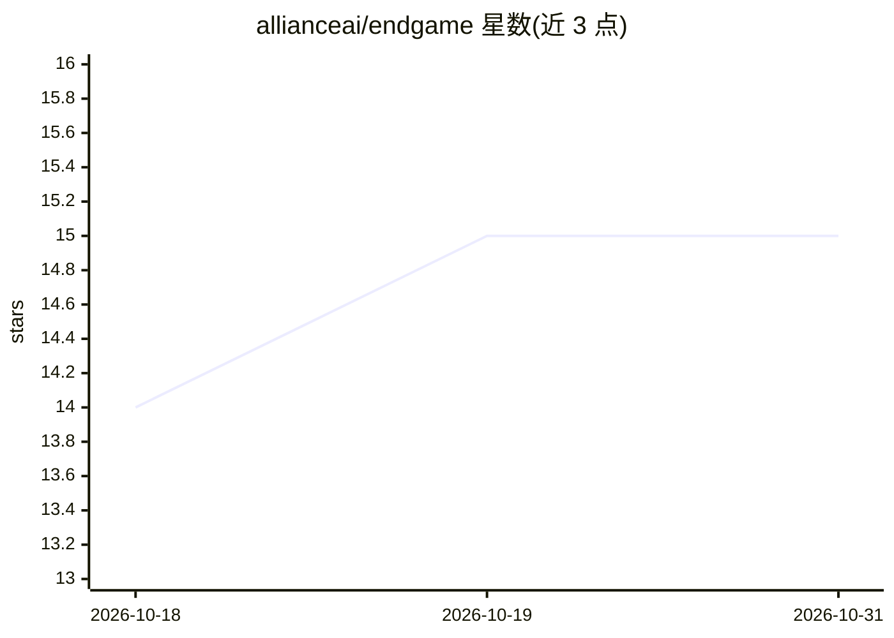

# allianceai/endgame

⭐ 15 · Python · Apache-2.0 · 推送 2026-10-11 · [GitHub](https://github.com/allianceai/endgame) · [官网](https://github.com/allianceai/endgame) · 组织维护

**面向生产部署的 sklearn 风格 ML 框架：校准、可解释、带 MCP**

扩展 scikit-learn API 的机器学习框架，覆盖表格、时间序列、视觉/NLP/音频等领域模块，提供多阶段 AutoML 流水线、Super Learner 集成、conformal prediction 与 Venn-ABERS 校准、泄漏检测等部署护栏。内置 MCP 服务器（21 个工具），让 Claude Code、Cursor、VS Code Copilot 等 AI agent 通过自然语言加载数据、训练模型并导出脚本。据 README，已在 Michael J. Fox Foundation 的帕金森分析引擎与 Alliance AI 生产环境使用，以 pip 包形式分发。

## 筛选速览

| 维度 | 判定 | 备注 |
|---|---|---|
| AI 角色 | `ai-native` | 本体是模型或模型工具 |
| 许可风险 | `permissive` | Apache-2.0 |
| 部署形态 | `library` | 以包/库形式分发 |
| 模型依赖 | — | README 未给出锁定关系 |
| 硬件要求 | — | 无带数字的原话,不猜 |
| 安装摩擦 | `low` | 无编译、无系统依赖或容器化 |
| 成熟度 | — | 结构信号不足 |

## 能力要点

- 内置 MCP 服务器（21 个工具），AI agent 可自然语言构建与评估 ML 流水线
- conformal prediction、Venn-ABERS 校准、泄漏检测等部署护栏
- 多阶段 AutoML：质量护栏、特征工程、HPO、集成、阈值优化
- 表格/时间序列/信号/视觉/NLP/音频统一 fit/predict 接口

## 适用场景

- 在高风险领域（医疗、金融）训练可审计且校准的模型
- 让 AI agent 通过对话完成数据加载到模型导出的全流程
- 生成含校准曲线与特征重要性的自包含 HTML 评估报告

## 场景标签

`MLOps` · 领域:训练与推理

## 证据(README 行号)

> L29: Endgame is a production-aware ML framework built for high-stakes domains where interpretability and calibration are
> L213: - **Calibrated, interpretable, sklearn-compatible.** Estimators spanning every major model family --- GBDTs, deep 

## 星数曲线

2026-10-18 14 → 2026-10-31 15（+1）

---
*卡片 v1 · prompt 1.4 · 生成 2026-10-30 · 置信度 low · 依据 README sha `99b4c66293eb` · [字段定义](../../DATASET.md)*
