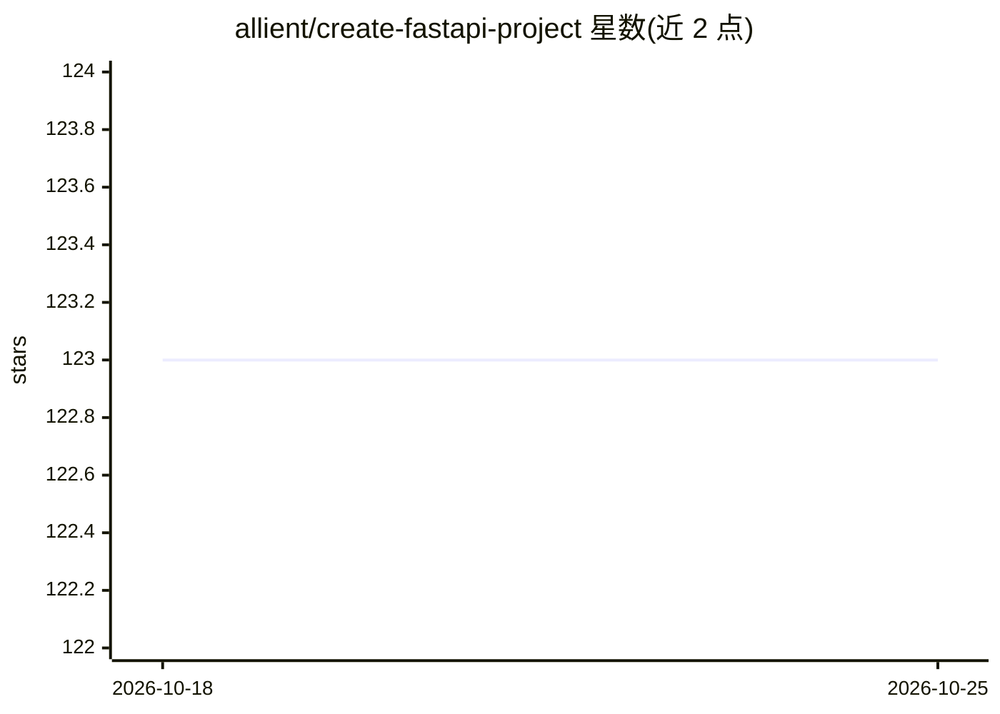

# allient/create-fastapi-project

⭐ 123 · Python · MIT · 推送 2026-03-09 · [GitHub](https://github.com/allient/create-fastapi-project) · [官网](https://pypi.org/project/create-fastapi-project) · 组织维护

**交互式 CLI：快速生成 FastAPI 项目脚手架（含 LangChain 模板）**

面向 FastAPI 开发者的项目脚手架生成工具：通过 pip 安装 create-fastapi-project 后运行交互式向导，从三类模板（Basic、Langchain Basic、Full）中选择并生成预配置的文件夹结构与依赖。Full 模板集成 FastAPI、异步 SQLModel、Alembic 迁移、JWT 认证、Celery 异步任务、Docker/Caddy/PostgreSQL/Redis/Minio/SonarQube 等组件；LangChain 模板含天气/图片/视频/Pokemon 检索工具与 OPENAI_API_KEY 环境变量配置。CLI 本身零外部依赖，由 Allient 团队维护。

## 筛选速览

| 维度 | 判定 | 备注 |
|---|---|---|
| AI 角色 | `ai-ecosystem` | LLM/agent 周边工具 |
| 许可风险 | `permissive` | MIT |
| 部署形态 | `library` | 以包/库形式分发 |
| 模型依赖 | — | README 未给出锁定关系 |
| 硬件要求 | — | 无带数字的原话,不猜 |
| 安装摩擦 | `medium` | 含编译或系统依赖之一 |
| 成熟度 | — | 结构信号不足 |

## 能力要点

- 交互式向导从三类模板生成 FastAPI 项目
- Full 模板含异步 CRUD、JWT 认证、Celery、Alembic 迁移
- LangChain 模板预置 4 个工具与容器化架构（Caddy 反向代理）
- CLI 零外部依赖，可通过 Makefile 以 Docker 或非 Docker 方式运行

## 适用场景

- 快速搭建带数据库与认证的 FastAPI 后端项目
- 以 LangChain 模板起步构建 LLM 应用后端
- 获得预配置的 Docker 容器化开发环境

## 场景标签

`代码生成` · 领域:编码与开发

## 证据(README 行号)

> L33: ### Langchain Basic
> L37:  We're thrilled to introduce you to the LangChain project template, designed to accelerate your development process

## 星数曲线

2026-10-18 123 → 2026-10-25 123（+0）

---
*卡片 v1 · prompt 1.4 · 生成 2026-10-23 · 置信度 high · 依据 README sha `754d35180d51` · [字段定义](../../DATASET.md)*
