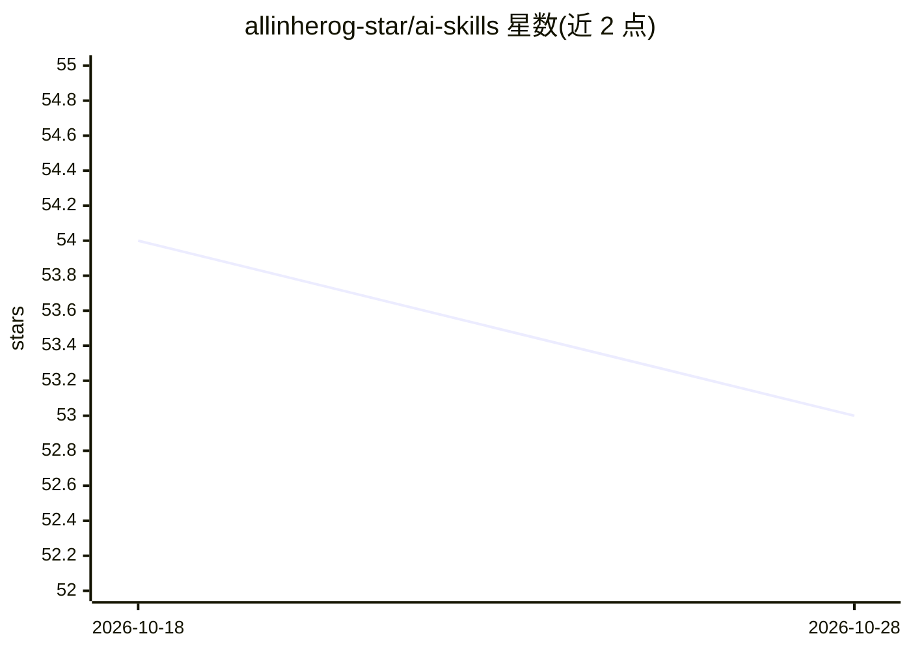

# allinherog-star/ai-skills

⭐ 53 · Python · 推送 2026-06-06 · [GitHub](https://github.com/allinherog-star/ai-skills) · [官网](https://ai-skills.ai) · 组织维护 · 中文 README

**面向职业与行业场景的 AI 技能库目录（245 个技能）**

ai-skills.ai 官网的技能库目录仓库：收录 245 个公开技能（其中 240 个标记为可直接运行），按平台运营、内容生产、SEO 与增长、电商经营等类别组织，每条含核心价值、适用场景与下载量。技能采用 SKILL.md 结构，可挂载到 Claude Code、Cursor 等 agent 客户端，或经官方 CLI 安装（写入 AISKILLS_API_KEY 后调用 skills add）。面向新媒体创作者、SEO/运营岗及行业专业岗位，另提供企业私有化对接入口。目录由导出器生成，互动统计只读平台记录。

## 筛选速览

| 维度 | 判定 | 备注 |
|---|---|---|
| AI 角色 | `ai-knowledge` | 知识聚合/清单类 |
| 许可风险 | `none` | — |
| 部署形态 | `None` |  |
| 模型依赖 | — | README 未给出锁定关系 |
| 硬件要求 | — | 无带数字的原话,不猜 |
| 安装摩擦 | `low` | 无编译、无系统依赖或容器化 |
| 成熟度 | — | 结构信号不足 |

## 能力要点

- 245 个公开技能按问题场景分类，240 个标记为可直接运行
- SKILL.md 结构可挂载到 Claude Code / Cursor 等自建 Agent 框架
- 官方 CLI 安装流程：扫码登录→申请 API Key→执行安装命令
- 提供按技能/职业/行业/场景四种检索入口与企业服务入口

## 适用场景

- 为抖音、小红书等平台运营找热点分析与增长类技能
- SEO/增长岗位按要解决的问题检索对应技能
- 把技能挂载进自己的 Agent 工作流中使用
- 企业按行业/岗位做私有化技能部署对接

## 场景标签

`精选清单` · 领域:学习与行业

## 证据(README 行号)

> L16: > AI Skills 官网是整个技能库的统一入口，可以按技能、职业、行业和应用场景归类的技能库。
> L84: 2. **放进自己的 Agent**：如果你在用 Claude Code / Cursor / 自建 Agent 框架，多数 Skill 都支持按 `SKILL.md` 结构被挂载——把 Skill 路径加进 agent 配置，就
> L103: > 数据更新：2026-05-27；数据源：public-catalog；统计口径：下载、收藏、分享来自平台互动表 `as_skill_engagement_counts.organic_count`，只展示真实事件或明确写入的

## 星数曲线

2026-10-18 54 → 2026-10-28 53（-1）

---
*卡片 v1 · prompt 1.4 · 生成 2026-10-24 · 置信度 high · 依据 README sha `c3b4d63a50bf` · [字段定义](../../DATASET.md)*
