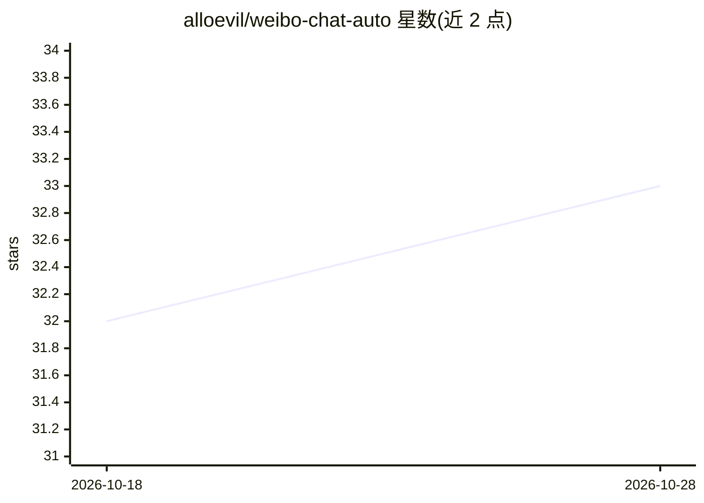

# alloevil/weibo-chat-auto

⭐ 33 · JavaScript · MIT · 推送 2026-10-28 · [GitHub](https://github.com/alloevil/weibo-chat-auto) · [官网](https://github.com/alloevil/weibo-chat-auto/releases/latest) · 个人维护 · 中文 README

**微博群聊消息本地归档桌面应用，含 AI 摘要与问答**

将微博群聊转为可检索的本地归档：以 Tauri 原生桌面应用形式提供（应用内扫码登录、自动 cookie 持久化），支持多群配置、增量归档、定时任务与按天 JSON 导出；查看器提供组合检索（发送人+日期+正文多词）、跨天上下文、统计面板与引用源核对。AI 部分为每日摘要与 Agentic 问答。目前桌面构建仅支持 Apple Silicon（macOS），未签名需右键打开；归档仍需 Chrome。另有 Web 版从源码运行。

## 筛选速览

| 维度 | 判定 | 备注 |
|---|---|---|
| AI 角色 | `ai-enhanced` | 去掉 AI 部分产品仍成立 |
| 许可风险 | `permissive` | MIT |
| 部署形态 | `desktop` | 安装包/桌面程序 |
| 模型依赖 | — | README 未给出锁定关系 |
| 硬件要求 | — | 无带数字的原话,不猜 |
| 安装摩擦 | `low` | 无编译、无系统依赖或容器化 |
| 成熟度 | — | 结构信号不足 |

## 能力要点

- Tauri 桌面应用，应用内扫码登录，无需手动配置 cookie
- 多群归档 + 增量断点续传 + 按天 JSON 导出 + 定时任务
- 组合检索（发送人/日期/正文多词）与跨天上下文、引用源核对
- AI 每日摘要与 Agentic 问答

## 适用场景

- 把微博群聊完整备份到本地并按日期浏览
- 按发送人、日期、关键词组合检索历史消息
- 让 AI 基于归档生成每日摘要并回答群聊相关问题

## 场景标签

`网页抓取` `文档问答` · 领域:效率与自动化

## 证据(README 行号)

> L19: Turn Weibo group chats into a searchable local archive — as a **native desktop app** (in-app QR-code login, no manu
> L69: ||🤖 AI daily summaries + agentic Q&A|

## 星数曲线

2026-10-18 32 → 2026-10-28 33（+1）

---
*卡片 v1 · prompt 1.4 · 生成 2026-10-26 · 置信度 high · 依据 README sha `b8da508dd2dd` · [字段定义](../../DATASET.md)*
