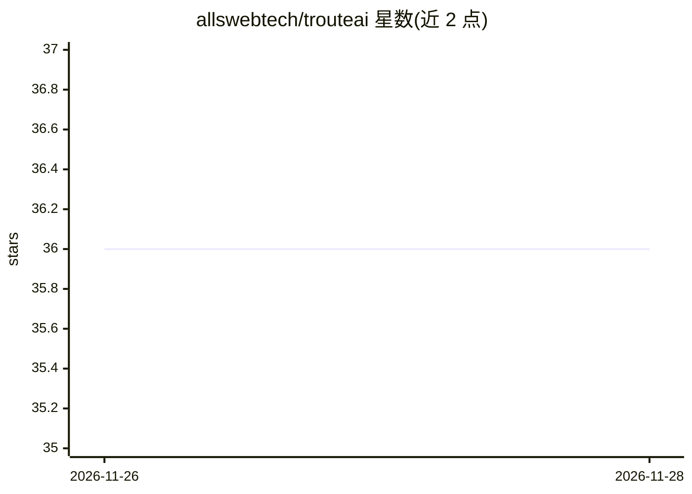

# allswebtech/trouteai

⭐ 36 · TypeScript · MIT · 推送 2026-11-27 · [GitHub](https://github.com/allswebtech/trouteai) · [官网](https://www.npmjs.com/package/trouteai) · 个人维护

**自托管 AI 网关：多 LLM 提供商统一接入、路由与回退**

开源自托管 AI 网关，以 Node.js 运行，用 SQLite 存数据。用户在 Web 面板添加 LLM 提供商、生成 API key，将兼容 OpenAI 或 Anthropic 格式的应用指向同一 base URL；combo 机制按顺序、轮询、加权等 17 种策略路由多模型，在错误或用量上限时回退。提供请求日志、用量与成本统计、凭据静态加密。需 Node.js 22.22.2+，可本地或经 SixPanel 部署到服务器。

## 筛选速览

| 维度 | 判定 | 备注 |
|---|---|---|
| AI 角色 | `ai-ecosystem` | LLM/agent 周边工具 |
| 许可风险 | `permissive` | MIT |
| 部署形态 | `library` | 以包/库形式分发 |
| 模型依赖 | local-ok | 支持本地模型 |
| 硬件要求 | — | 无带数字的原话,不猜 |
| 安装摩擦 | `low` | 无编译、无系统依赖或容器化 |
| 成熟度 | — | 结构信号不足 |

## 能力要点

- 单一 /v1 API 同时兼容 OpenAI 与 Anthropic 格式，内置 290+ 提供商
- combo 多模型回退与 17 种路由策略，用量上限账号自动跳过
- Web 面板管理提供商、API key、日志与用量统计
- 本地运行无需遥测，凭据加密存储

## 适用场景

- 让 Claude Code、Codex CLI 等编码代理工具统一走自建网关
- 为不同应用分配独立 API key 并分别追踪用量
- 配置多模型回退链，在一个提供商报错或限额时切换
- 在自有服务器上托管并集中管理多家 LLM 凭据

## 场景标签

`模型网关` · 领域:Agent 开发

## 证据(README 行号)

> L7:  An open-source, self-hosted AI gateway to route, manage, and optimize multiple LLM providers
> L57: - **One API for every provider.** OpenAI format (`/v1/chat/completions`, `/v1/responses`,
> L66: - **Lite and private.** Runs on your computer or server (Node.js and SQLite), near-zero CPU when

## 星数曲线

2026-11-26 36 → 2026-11-28 36（+0）

---
*卡片 v1 · prompt 1.4 · 生成 2026-11-26 · 置信度 high · 依据 README sha `3da098b08f1a` · [字段定义](../../DATASET.md)*
