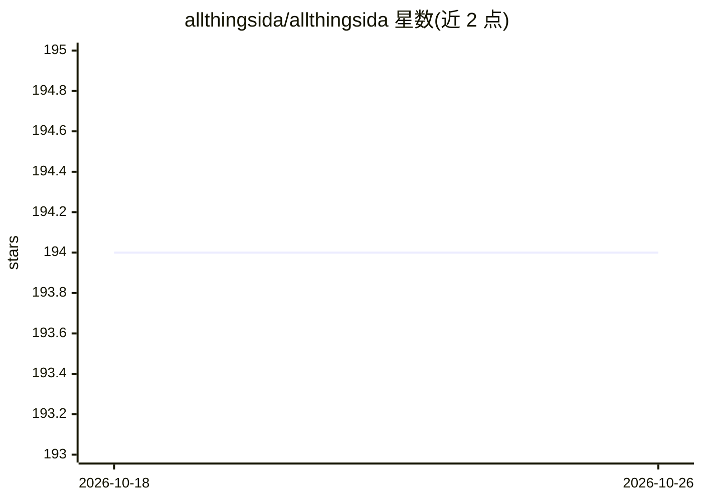

# allthingsida/allthingsida

⭐ 194 · Assembly · NOASSERTION · 推送 2026-07-20 · [GitHub](https://github.com/allthingsida/allthingsida) · [官网](https://www.youtube.com/@allthingsida) · 个人维护

**IDA Pro 逆向工程视频频道的配套代码片段合集**

All Things IDA YouTube 频道与 X 账号的官方代码仓库，收录视频中演示的源代码与脚本，主题涉及 IDA Pro、Hex-Rays 反编译器、底层编程、逆向工程及机器学习与提示工程相关内容。代码仅用于教学目的，仓库声明不应在生产环境部署，使用条款见 LICENSE 文件，另有 Buy Me a Coffee 赞助链接。

## 筛选速览

| 维度 | 判定 | 备注 |
|---|---|---|
| AI 角色 | `ai-knowledge` | 知识聚合/清单类 |
| 许可风险 | `none` | NOASSERTION |
| 部署形态 | `None` |  |
| 模型依赖 | — | README 未给出锁定关系 |
| 硬件要求 | — | 无带数字的原话,不猜 |
| 安装摩擦 | `low` | 无编译、无系统依赖或容器化 |
| 成熟度 | — | 结构信号不足 |

## 能力要点

- 视频频道配套的源代码与脚本集合
- 覆盖 IDA Pro 与 Hex-Rays 反编译器相关脚本
- 主题标签含机器学习与提示工程方向

## 适用场景

- 跟随视频学习 IDA Pro 逆向工程脚本编写
- 查找 Hex-Rays 反编译器相关的代码示例
- 了解逆向工程中结合机器学习的示例做法

## 场景标签

`教程课程` · 领域:学习与行业

## 证据(README 行号)

> L3: This is the official code repository for the All Things IDA YouTube Channel and X account.
> L5: Here, you'll find most of the source code featured in our videos. The code/scripts are intended solely for education

## 星数曲线

2026-10-18 194 → 2026-10-26 194（+0）

---
*卡片 v1 · prompt 1.4 · 生成 2026-10-22 · 置信度 mid · 依据 README sha `1ed985026d8e` · [字段定义](../../DATASET.md)*
