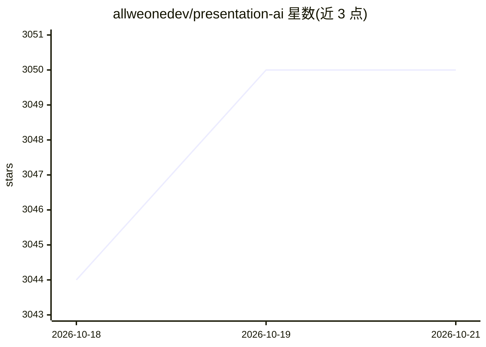

# allweonedev/presentation-ai

⭐ 3,050 · TypeScript · MIT · 推送 2026-06-05 · [GitHub](https://github.com/allweonedev/presentation-ai) · [官网](https://presentation.allweone.com) · 组织维护

**开源自托管 AI 演示文稿生成器，Gamma 替代**

基于 Next.js/React/TypeScript 的 Web 应用，用户输入主题后先生成大纲、经确认再生成幻灯片，支持选择文本模型（OpenAI、Ollama、LM Studio）、语言、页数与联网搜索。提供 38 个内置主题、自定义主题、PPTX 主题导入、AI 配图、图表与媒体嵌入，可演示、录制、公开分享并导出 .pptx。部署需 Node.js 18+、PostgreSQL 与 Google 登录凭据，通过 pnpm 安装运行，属 ALLWEONE 平台组件，MIT 许可。

## 筛选速览

| 维度 | 判定 | 备注 |
|---|---|---|
| AI 角色 | `ai-native` | 本体是模型或模型工具 |
| 许可风险 | `permissive` | MIT |
| 部署形态 | `library` | 以包/库形式分发 |
| 模型依赖 | local-ok | 支持本地模型 |
| 硬件要求 | — | 无带数字的原话,不猜 |
| 安装摩擦 | `low` | 无编译、无系统依赖或容器化 |
| 成熟度 | — | 结构信号不足 |

## 能力要点

- 大纲优先工作流：先生成可编辑大纲再生成幻灯片
- 支持 OpenAI/Together AI/Ollama/LM Studio 等多种文本与图像模型
- 38 个内置主题，支持自定义主题与 PPTX 主题导入
- 演示模式、录制、公开分享与 .pptx 导出

## 适用场景

- 自托管一个可自选模型的 AI 幻灯片生成服务
- 用本地 Ollama/LM Studio 模型离线生成演示内容
- 按品牌自定义主题并导出 PowerPoint 文件

## 场景标签

`AI 写作` · 领域:内容生成

## 证据(README 行号)

> L10: An open-source, AI-powered presentation generator alternative to Gamma.app that creates beautiful, customizable sli
> L29: - **AI-Powered Content Generation**: Create complete presentations on any topic with AI
> L63: |**AI Integration**|OpenAI API, Together AI, Ollama, LM Studio|

## 星数曲线

2026-10-18 3,044 → 2026-10-21 3,050（+6）

---
*卡片 v1 · prompt 1.4 · 生成 2026-10-20 · 置信度 high · 依据 README sha `89d1747b0b23` · [字段定义](../../DATASET.md)*
