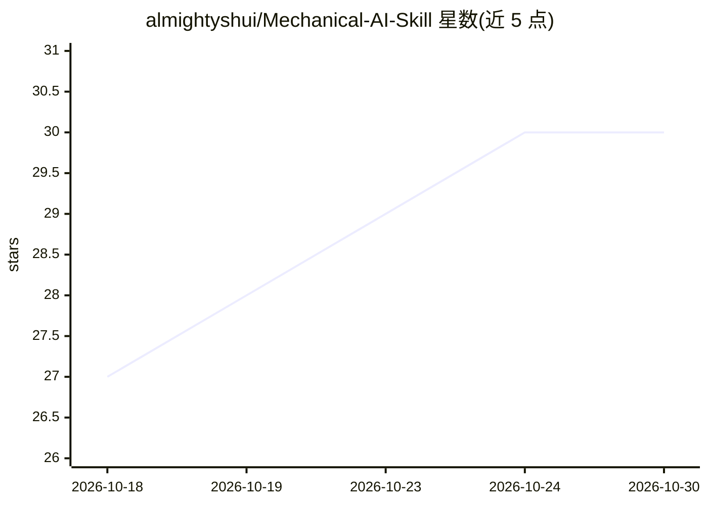

# almightyshui/Mechanical-AI-Skill

⭐ 30 · Python · MIT · 推送 2026-06-17 · [GitHub](https://github.com/almightyshui/Mechanical-AI-Skill) · 个人维护

**让 AI agent 审阅机械装配体的工程审查技能**

面向 Claude Code / Codex / Cursor 等 AI agent 的机械工程审查技能（SKILL 层）：读取 STEP 装配文件，在无 SolidWorks 和几何内核的情况下输出装配结构摘要、名称级 BOM、机构与厂商识别、干涉/间隙近似检查、规则式 DFM/DFA、静力与模态分析及 PDF/HTML 报告；有 SolidWorks 时运行生产级检查。所有结果带 status 与假设声明，几何相关检查标记为近似。采用 Community（免费）/ Professional 双版本，高级能力需许可核心，社区版命令返回 enterprise_required。

## 筛选速览

| 维度 | 判定 | 备注 |
|---|---|---|
| AI 角色 | `ai-ecosystem` | LLM/agent 周边工具 |
| 许可风险 | `permissive` | MIT |
| 部署形态 | `None` |  |
| 模型依赖 | — | README 未给出锁定关系 |
| 硬件要求 | — | 无带数字的原话,不猜 |
| 安装摩擦 | `low` | 无编译、无系统依赖或容器化 |
| 成熟度 | — | 结构信号不足 |

## 能力要点

- 仅凭 STEP 文件生成 BOM、装配树、机构/厂商识别与执行摘要
- 干涉/间隙检查、规则式 DFM、DFA、静力/模态分析与风险评分
- PDF/HTML 工程报告，结果均带 status 与假设/警示
- 无 SolidWorks 时优雅降级（近似检查或生成宏），不伪造输出

## 适用场景

- 让 AI agent 从 STEP 文件理解装配结构并生成 BOM
- 对装配体做干涉、DFM/DFA 与风险初筛并出报告
- 设计评审前快速回答这个装配是什么、哪里值得再看

## 场景标签

 · 领域:机械工程/CAD 审查工具

## 证据(README 行号)

> L15: > **Not another CAD copilot.** Mechanical AI Skill focuses on engineering **understanding and review** — not geomet
> L137: The skill sits between your AI agent and the real CAD/CAE tools, exposing one stable JSON contract. Free capabilit

## 星数曲线

2026-10-18 27 → 2026-10-30 30（+3）

---
*卡片 v1 · prompt 1.4 · 生成 2026-10-26 · 置信度 high · 依据 README sha `5b8ead4f8cdc` · [字段定义](../../DATASET.md)*
