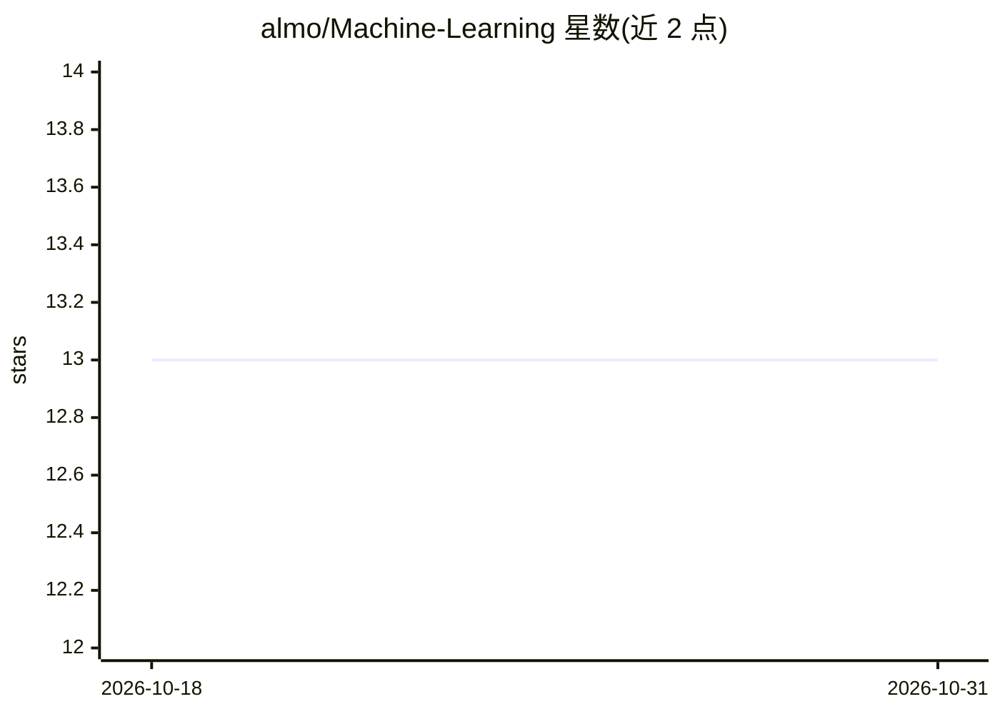

# almo/Machine-Learning

⭐ 13 · Kotlin · 推送 2026-08-16 · [GitHub](https://github.com/almo/Machine-Learning) · 个人维护

**Kotlin 机器学习代码片段与用例集合**

收录机器学习算法片段与使用场景的代码仓库，主题标签标注为 algorithms、apache2、cloud、kotlin、machine-learning。README 仅两行，说明其为片段（snippets）与用例（use cases）汇编，未描述具体算法清单、依赖框架或运行方式。许可证标注为 Apache-2，语言以 Kotlin 为主。信息不足以判断维护活跃度与覆盖范围。

## 筛选速览

| 维度 | 判定 | 备注 |
|---|---|---|
| AI 角色 | `ai-knowledge` | 知识聚合/清单类 |
| 许可风险 | `none` | — |
| 部署形态 | `None` |  |
| 模型依赖 | — | README 未给出锁定关系 |
| 硬件要求 | — | 无带数字的原话,不猜 |
| 安装摩擦 | `low` | 无编译、无系统依赖或容器化 |
| 成熟度 | — | 结构信号不足 |

## 能力要点

- 机器学习算法片段与用例汇编
- 以 Kotlin 语言编写
- Apache-2 许可证

## 适用场景

- 查找 Kotlin 实现的机器学习算法参考代码
- 浏览常见机器学习用例写法

## 场景标签

 · 领域:机器学习/代码示例

## 证据(README 行号)

> L2: Machine Learning snippets and use cases.

## 星数曲线

2026-10-18 13 → 2026-10-31 13（+0）

---
*卡片 v1 · prompt 1.4 · 生成 2026-10-31 · 置信度 low · 依据 README sha `060769918bdb` · [字段定义](../../DATASET.md)*
