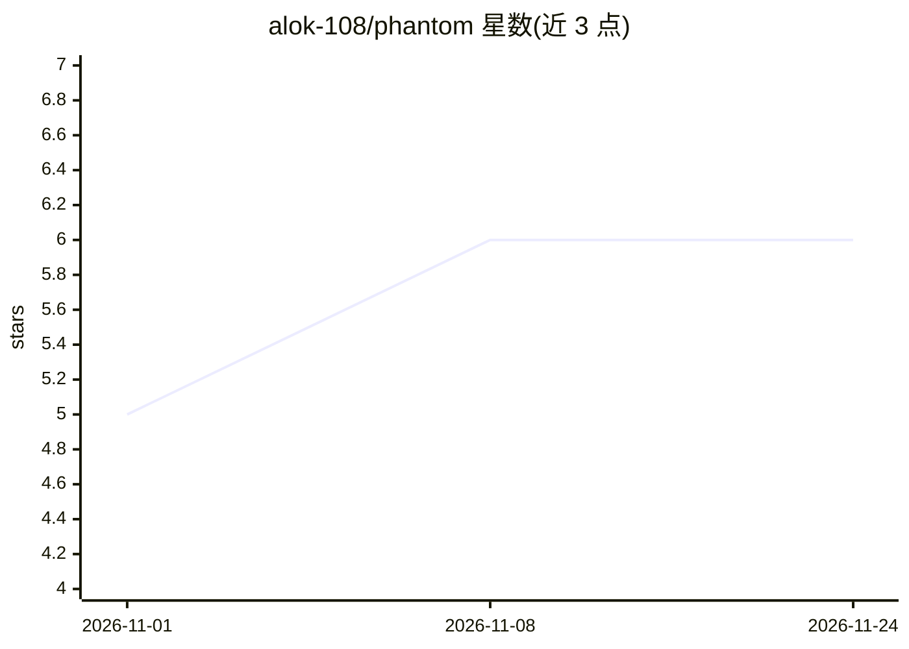

# alok-108/phantom

⭐ 6 · Python · MIT · 推送 2026-11-22 · [GitHub](https://github.com/alok-108/phantom) · [官网](https://github.com/hayagrivai-labs/phantom/blob/main/docs/QUICKSTART.md) · 个人维护 · 中文 README

**给 Python 开发者的双层注释指令层：校验与 LLM 差异化生成**

Phantom 是一个双层编程概念的工具：普通 Python 源码之外，在注释（或空白/零宽字符）中嵌入第二层结构化指令，不引入 import、装饰器或包装。提供 check/inspect/run/generate/diff/verify 六个 CLI 命令：形式文法校验与 SARIF 导出、不可见字符审计、指令在宿主启动前应用执行。可选的 LLM 生成器（Gemini）以独立候选文件形式提出修改，要求与原文件 AST 完全一致且只插入行、不覆写。无运行时依赖，需 Python ≥ 3.10，尚未发布到 PyPI。

## 筛选速览

| 维度 | 判定 | 备注 |
|---|---|---|
| AI 角色 | `ai-ecosystem` | LLM/agent 周边工具 |
| 许可风险 | `permissive` | MIT |
| 部署形态 | `library` | 以包/库形式分发 |
| 模型依赖 | — | README 未给出锁定关系 |
| 硬件要求 | — | 无带数字的原话,不猜 |
| 安装摩擦 | `low` | 无编译、无系统依赖或容器化 |
| 成熟度 | `idea` | |

## 能力要点

- 第二指令层支持注释、空白、零宽 Unicode、混合四种编码
- phantom generate 仅插入行，接受候选须 AST 与原文件一致
- check/inspect/diff 不执行不改写文件，并有不可见字符严格审计
- 无运行时依赖，无网络使用（generate 且用户同意除外）

## 适用场景

- 把脚手架信息（元数据、计数器、诊断）与业务代码分离存放
- 让 LLM 以可校验 diff 的方式为代码追加指令层
- 审计代码中的不可见/双向字符

## 场景标签

`代码生成` · 领域:编码与开发

## 证据(README 行号)

> L18: **Phantom** is a dual-layer programming concept: ordinary Python source plus a second, structured *instruction laye
> L69: - Optional LLM-assisted generator that proposes a *separate candidate file* and checks it (GENERATOR.md).

## 星数曲线

2026-11-01 5 → 2026-11-24 6（+1）

---
*卡片 v1 · prompt 1.4 · 生成 2026-11-20 · 置信度 mid · 依据 README sha `05caaa043359` · [字段定义](../../DATASET.md)*
