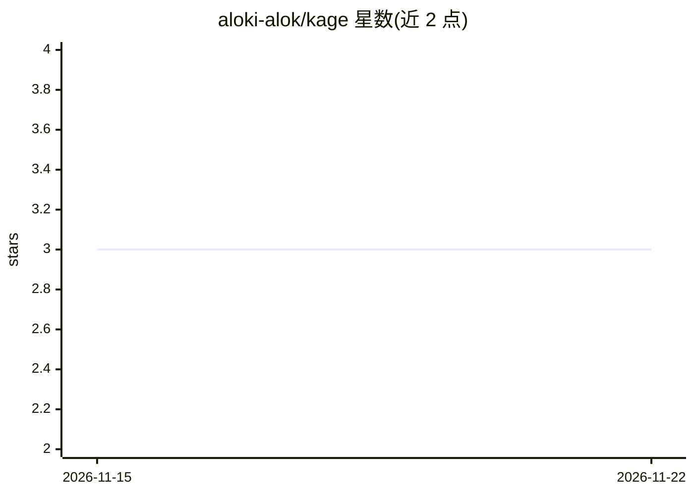

# aloki-alok/kage

⭐ 3 · TypeScript · NOASSERTION · 推送 2026-11-21 · [GitHub](https://github.com/aloki-alok/kage) · [官网](https://aloki-alok.github.io/kage/) · 个人维护

**把 Claude Code 会话接入 Slack/电话/浏览器的个人代理网关**

Kage 将用户本机已登录的 Claude Code 会话通过 Slack @提及等方式远程调用：在任意线程里触发本机 agent 执行任务并把结果回复到该线程，使用用户自身的配置与访问权限；可为 teammates 及其 agent、语音来电或 Meet 访客设置不同权限级别。要求 macOS 或 Linux、Node 22.18+、已登录 Claude Code，通过 curl 安装脚本安装，配套 Slack OAuth 授权流程、kage doctor 故障诊断与 kagelets 等机制。

## 筛选速览

| 维度 | 判定 | 备注 |
|---|---|---|
| AI 角色 | `ai-ecosystem` | LLM/agent 周边工具 |
| 许可风险 | `none` | NOASSERTION |
| 部署形态 | `None` |  |
| 模型依赖 | locked-api |  |
| 硬件要求 | — | 无带数字的原话,不猜 |
| 安装摩擦 | `low` | 无编译、无系统依赖或容器化 |
| 成熟度 | — | 结构信号不足 |

## 能力要点

- 在 Slack 线程中 @提及 即触发本机 Claude Code 会话并回帖
- 为 teammates、语音来电与 Meet 访客提供分级权限
- kage doctor 命令诊断故障
- 支持由编码 agent 代为完成安装流程

## 适用场景

- 不在电脑前时通过 Slack 调用本机编码 agent 处理事务
- 让 agent 以自己的身份和权限回复同事提问
- 团队成员以受限权限共用同一 agent

## 场景标签

`编码 Agent` · 领域:编码与开发

## 证据(README 行号)

> L3: Kage is your own Claude Code, reachable from Slack. Tag `@kage` in any thread and a Claude Code session on your mach
> L18: You need macOS or Linux, Node 22.18 or newer, and Claude Code logged in.

## 星数曲线

2026-11-15 3 → 2026-11-22 3（+0）

---
*卡片 v1 · prompt 1.4 · 生成 2026-11-22 · 置信度 high · 依据 README sha `e199901e5d2b` · [字段定义](../../DATASET.md)*
