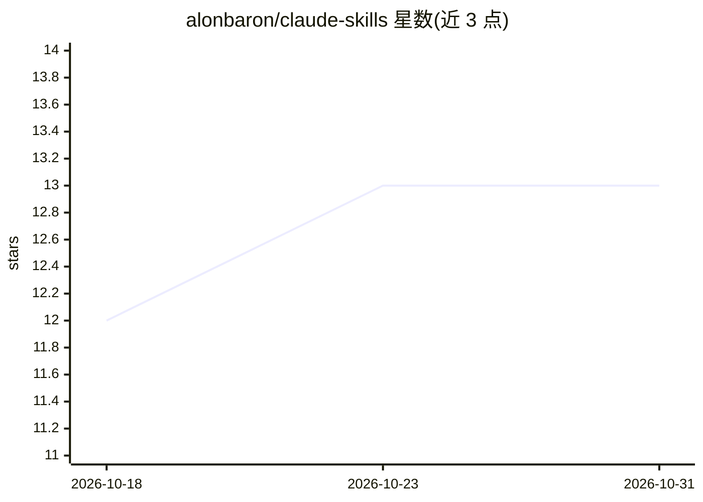

# alonbaron/claude-skills

⭐ 13 · JavaScript · MIT · 推送 2026-10-25 · [GitHub](https://github.com/alonbaron/claude-skills) · [官网](https://github.com/alonbaron/claude-skills/releases/latest) · 个人维护

**六个 Claude Code 技能与无人值守构建循环的插件包**

面向 Claude Code CLI 与 VS Code 扩展的插件集：包含 architect（设计文档）、review-swarm（并行评审）、ask-the-council（多顾问决策）、prompt-generator（提示词生成）、up-to-date（同步预检）、ponytail（最简实现）六个技能，以及 build-loop 无人值守构建循环——按 plan/scout/spec/build/refute/fix/close 等阶段逐行推进 TODO_WORKFLOW.md，状态存于仓库而非聊天。19 个评测用例在 Fable 5.1 上 0.7 阈值全部通过，并以开/关插件对照展示分数。通过 /plugin 命令安装，ponytail 技能 vendored 自第三方（MIT）。

## 筛选速览

| 维度 | 判定 | 备注 |
|---|---|---|
| AI 角色 | `ai-ecosystem` | LLM/agent 周边工具 |
| 许可风险 | `permissive` | MIT |
| 部署形态 | `None` |  |
| 模型依赖 | locked-api |  |
| 硬件要求 | — | 无带数字的原话,不猜 |
| 安装摩擦 | `low` | 无编译、无系统依赖或容器化 |
| 成熟度 | — | 结构信号不足 |

## 能力要点

- 六个技能均支持自然语言触发并按任务形态主动激活（含触发/静默边界表）
- build-loop 无人值守循环：每阶段独立子agent、空上下文、状态存于仓库，支持多镜头反驳与修复轮
- claude plugin eval 19/19 用例在开/关插件对照下通过（0.7 阈值）
- 提供 node autobuild.mjs 无人值守驱动与锁文件防并发

## 适用场景

- 在 Claude Code 中让设计、评审、决策等环节按流程自动介入
- 无人值守逐任务推进 TODO_WORKFLOW.md 并自动评审修复
- 生成给其他 agent 使用的严格提示词

## 场景标签

`多智能体` `提示工程` `代码审查` `编码 Agent` · 领域:Agent 开发

## 证据(README 行号)

> L16: /plugin marketplace add alonbaron/claude-skills
> L21: Works in the Claude Code CLI and the VS Code extension. Tested on macOS and Windows.
> L39: `alon-skills` holds six skills and one unattended build loop, tuned to one consistent working style: model-first, f

## 星数曲线

2026-10-18 12 → 2026-10-31 13（+1）

---
*卡片 v1 · prompt 1.4 · 生成 2026-10-31 · 置信度 high · 依据 README sha `bd4a572bbba2` · [字段定义](../../DATASET.md)*
