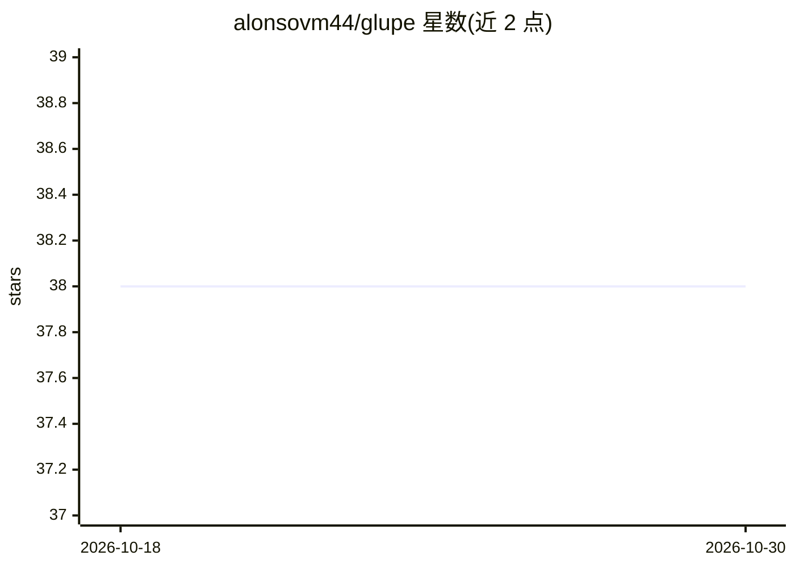

# alonsovm44/glupe

⭐ 38 · C++ · NOASSERTION · 推送 2026-03-30 · [GitHub](https://github.com/alonsovm44/glupe) · 个人维护

**约束 AI 生成代码范围的 CLI 层：LLM 只能填写标记块**

用 C++17 编写的命令行工具，在源码文件中通过 $$ { ... } $$ 标记出允许 AI 填写的空白区域，其余代码保持不变。工作流程：扫描文件、提取标记块、仅将块内容发送给 LLM、将生成代码注入回文件，可选编译并在编译失败时自动重试。编译并通过测试的块按哈希锁定在 .glupe.lock 中不再重新生成，类似增量编译。支持本地模型（如 qwen2.5-coder）与云端模型（配置 API key，如 gemini-1.5-flash），另提供 fix/explain/diff/sos 工具命令。限制：LLM 输出仍非确定性，需要在容器内书写，相比直接提示多一步操作。提供预编译二进制与安装脚本。

## 筛选速览

| 维度 | 判定 | 备注 |
|---|---|---|
| AI 角色 | `ai-ecosystem` | LLM/agent 周边工具 |
| 许可风险 | `permissive` | NOASSERTION |
| 部署形态 | `desktop` | 安装包/桌面程序 |
| 模型依赖 | — | README 未给出锁定关系 |
| 硬件要求 | — | 无带数字的原话,不猜 |
| 安装摩擦 | `low` | 无编译、无系统依赖或容器化 |
| 成熟度 | — | 结构信号不足 |

## 能力要点

- AI 只能在 $$ { ... } $$ 块内生成代码，其余部分保证不变
- 通过 .glupe.lock 哈希锁定已通过编译/测试的块，避免重复生成
- 编译失败自动重试修复，支持多文件输出（EXPORT 语法）
- 本地模型与云端模型双通道，附 fix/explain/diff/sos 工具命令

## 适用场景

- 在真实代码库中引入 LLM 辅助编码但不想 AI 重写整个文件
- 让 AI 填写我预先设计的函数结构并获得可审查的 diff
- 对 AI 生成代码锁定已验证结果以保证可复现构建

## 场景标签

`代码生成` · 领域:编码与开发

## 证据(README 行号)

> L11: LLMs are powerful, but unconstrained generation is dangerous. Glupe is a CLI tool that acts as a **strict constrain
> L138: Glupe is a thin layer between your code and an LLM:
> L142: 3. sends only those blocks to the model

## 星数曲线

2026-10-18 38 → 2026-10-30 38（+0）

---
*卡片 v1 · prompt 1.4 · 生成 2026-10-25 · 置信度 high · 依据 README sha `cbbc0e9c8e31` · [字段定义](../../DATASET.md)*
