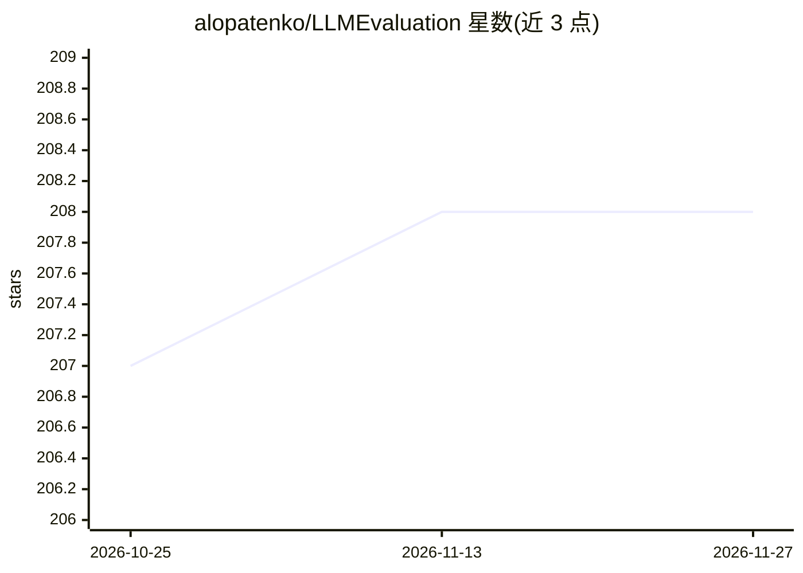

# alopatenko/LLMEvaluation

⭐ 208 · HTML · 推送 2026-11-14 · [GitHub](https://github.com/alopatenko/LLMEvaluation) · [官网](https://alopatenko.github.io/LLMEvaluation/) · 个人维护

**面向学界与业界从业者精选 LLM 评估方法与资源的指南**

一个 awesome 型清单仓库，按主题目录组织 LLM 评估领域的方法汇编：收录综述论文、排行榜与竞技场、评估软件工具、基准与元评估、多语言/推理/幻觉等核心评估专题、安全与对齐、Agent 评估、RAG 与垂直行业评估等条目。条目以论文、排行榜、工具仓库的链接形式提供，作者声明会定期更新。目标读者为需要为特定任务选择评估方法的学术与行业人员。仓库本身不含可运行代码，未提供安装方式。

## 筛选速览

| 维度 | 判定 | 备注 |
|---|---|---|
| AI 角色 | `ai-knowledge` | 知识聚合/清单类 |
| 许可风险 | `none` | — |
| 部署形态 | `None` |  |
| 模型依赖 | — | README 未给出锁定关系 |
| 硬件要求 | — | 无带数字的原话,不猜 |
| 安装摩擦 | `low` | 无编译、无系统依赖或容器化 |
| 成熟度 | — | 结构信号不足 |

## 能力要点

- 按 Foundations/Benchmarks/Core/Trust/Agentic/Systems/Verticals 等专题组织条目
- 收录 LLM-as-Judge、HITL、元评估等评估方法的综述与论文
- 汇总 HuggingFace、LMSys Arena、MTEB、SWE Bench 等排行榜链接
- 列出 EleutherAI Harness、RAGAS、DeepEval 等评估工具

## 适用场景

- 为某个具体任务寻找合适的 LLM 评估基准与方法
- 查找某领域（医疗/法律/金融）的模型评估综述
- 了解 Agent、RAG、多语言等系统的评估资源

## 场景标签

`精选清单` · 领域:学习与行业

## 证据(README 行号)

> L3: ## Compendium of LLM Evaluation methods
> L5: The aim of this compendium is to assist academics and industry professionals in creating effective evaluation suites
> L15: # Table of contents

## 星数曲线

2026-10-25 207 → 2026-11-27 208（+1）

---
*卡片 v1 · prompt 1.4 · 生成 2026-11-25 · 置信度 high · 依据 README sha `0a329f06a15d` · [字段定义](../../DATASET.md)*
