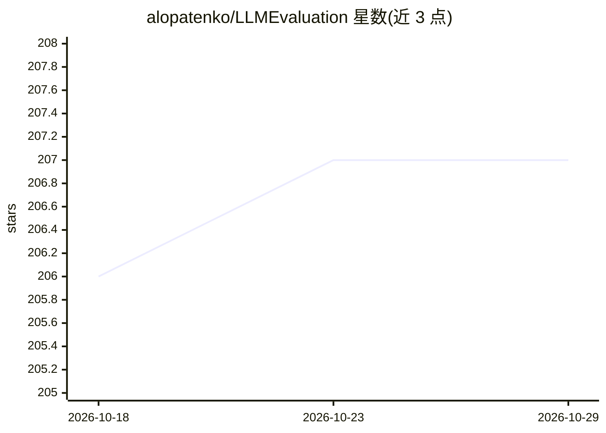

# alopatenko/LLMEvaluation

⭐ 207 · HTML · 推送 2026-10-27 · [GitHub](https://github.com/alopatenko/LLMEvaluation) · [官网](https://alopatenko.github.io/LLMEvaluation/) · 个人维护

**LLM 与 LLM 系统评测方法综合清单（评测论文/基准/工具策展）**

由个人维护的 LLM 评测方法 compendium：按基础、基准与元评测、核心能力评测（嵌入/幻觉/推理/多语言等）、可信与安全、Agentic AI、AGI、任务能力、LLM 系统（RAG/对话/Copilot）及垂直行业（医疗/法律/金融）等类别，系统收录综述论文、Leaderboard 与评测工具框架（EleutherAI Harness、OpenAI Evals、RAGAS、DeepEval、Promptfoo 等），并说明计划持续更新，附作者演讲与视频链接。无安装运行代码，纯资源目录。

## 筛选速览

| 维度 | 判定 | 备注 |
|---|---|---|
| AI 角色 | `ai-knowledge` | 知识聚合/清单类 |
| 许可风险 | `none` | — |
| 部署形态 | `None` |  |
| 模型依赖 | — | README 未给出锁定关系 |
| 硬件要求 | — | 无带数字的原话,不猜 |
| 安装摩擦 | `low` | 无编译、无系统依赖或容器化 |
| 成熟度 | — | 结构信号不足 |

## 能力要点

- 按约 20 个主题类别组织评测论文、基准与工具条目
- 覆盖评测软件框架清单（EleutherAI Harness/OpenAI Evals/RAGAS/DeepEval 等）
- 包含垂直行业（医疗/法律/科学/金融）评测资源与元评测（评测之评测）部分

## 适用场景

- 为 LLM 或 LLM 应用选型时查找合适的评测方法与基准
- 研究者查找 LLM 评测领域的综述与最新论文
- 团队挑选评测工具框架（如 RAGAS、DeepEval、Promptfoo）

## 场景标签

`模型评测` `精选清单` · 领域:评测与运维

## 证据(README 行号)

> L1: # Awesome LLM Evaluation
> L3: ## Compendium of LLM Evaluation methods
> L5: The aim of this compendium is to assist academics and industry professionals in creating effective evaluation suites

## 星数曲线

2026-10-18 206 → 2026-10-29 207（+1）

---
*卡片 v1 · prompt 1.4 · 生成 2026-10-23 · 置信度 high · 依据 README sha `8b78d6c657a5` · [字段定义](../../DATASET.md)*
