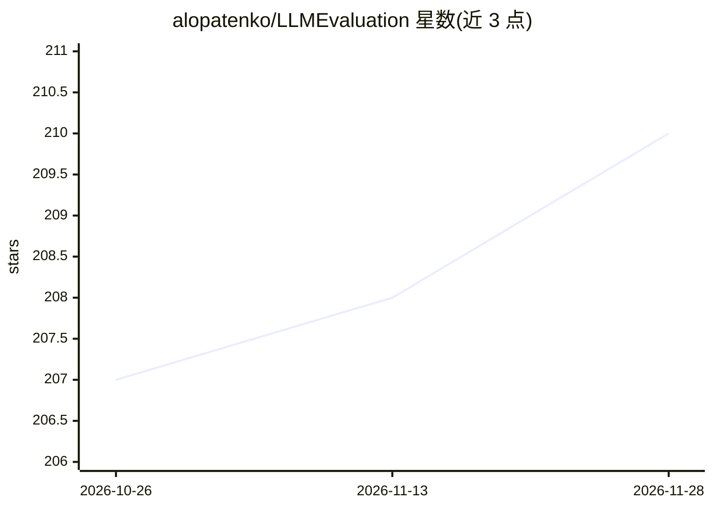

# alopatenko/LLMEvaluation

⭐ 210 · HTML · 推送 2026-11-27 · [GitHub](https://github.com/alopatenko/LLMEvaluation) · [官网](https://alopatenko.github.io/LLMEvaluation/) · 个人维护

**面向研究者与从业者的 LLM 评测方法论文献汇编清单**

一个以文献目录形式组织的 LLM 评测方法汇总（awesome list），收录综述论文、排行榜、基准数据集与评测软件的链接，按基础文献、基准与元评测、核心能力评测、信任与安全、Agentic AI、任务专项、RAG/对话系统、医疗/法律/金融垂直领域等类别组织条目。作者声明计划定期更新。仓库本身不提供可运行的代码或工具，仅提供链接与分类导航，帮助学术与行业人员查找适合其任务的评测方法。

## 筛选速览

| 维度 | 判定 | 备注 |
|---|---|---|
| AI 角色 | `ai-knowledge` | 知识聚合/清单类 |
| 许可风险 | `none` | — |
| 部署形态 | `None` |  |
| 模型依赖 | — | README 未给出锁定关系 |
| 硬件要求 | — | 无带数字的原话,不猜 |
| 安装摩擦 | `low` | 无编译、无系统依赖或容器化 |
| 成熟度 | — | 结构信号不足 |

## 能力要点

- 按主题分类收录 LLM 评测综述、基准与排行榜链接
- 设 Evaluation Software 一节列举评测框架与工具
- 覆盖 Agent 评测、RAG 评测、多语言、安全红队等专项条目
- 含垂直领域（医疗/法律/科学/金融）评测资源

## 适用场景

- 为自己的 LLM 应用挑选合适的评测基准
- 查阅某领域（如医疗问答、代码生成）已有评测文献
- 了解排行榜与 LLM-as-Judge 等评测方法的研究现状

## 场景标签

`精选清单` `模型评测` `科研工具` · 领域:评测与运维

## 证据(README 行号)

> L1: # Awesome LLM Evaluation
> L3: ## Compendium of LLM Evaluation methods
> L5: The aim of this compendium is to assist academics and industry professionals in creating effective evaluation suites

## 星数曲线

2026-10-26 207 → 2026-11-28 210（+3）

---
*卡片 v1 · prompt 1.4 · 生成 2026-11-28 · 置信度 high · 依据 README sha `c695aeb4e795` · [字段定义](../../DATASET.md)*
