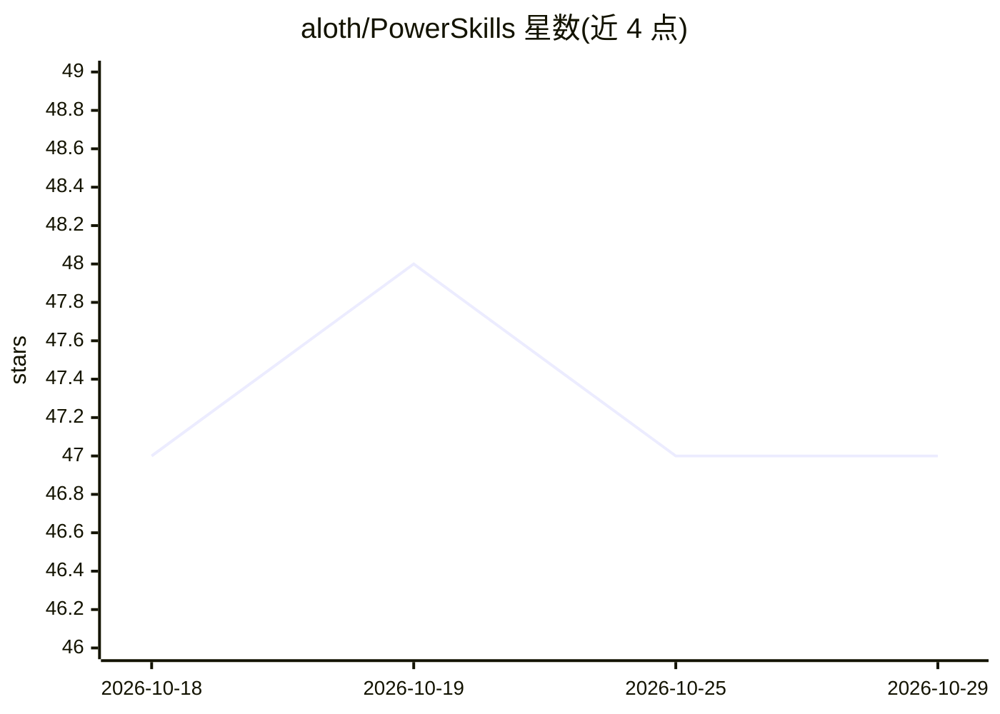

# aloth/PowerSkills

⭐ 47 · PowerShell · MIT · 推送 2026-09-06 · [GitHub](https://github.com/aloth/PowerSkills) · [官网](https://github.com/aloth/PowerSkills#readme) · 个人维护

**给 AI agent 的 Windows PowerShell 技能工具箱：输出结构化 JSON**

面向 AI agent 的 Windows 能力工具集，以 PowerShell 技能形式提供 Outlook 邮件/日历（COM）、Microsoft 365（Work IQ CLI）、Edge 浏览器自动化（CDP）、桌面操作（截图/窗口/按键）与系统控制（shell/进程）五大技能，所有命令返回统一 JSON 信封（status/exit_code/data/timestamp）。每个技能含 SKILL.md 供 agent 自主发现，支持 npx skills add 安装或 git clone 后经 powerskills.ps1 调度，也可单独调用各技能脚本。要求 Windows 10/11 与 PowerShell 5.1+，无其他依赖；outlook/browser 技能分别需 Outlook 与开启调试端口的 Edge。

## 筛选速览

| 维度 | 判定 | 备注 |
|---|---|---|
| AI 角色 | `ai-ecosystem` | LLM/agent 周边工具 |
| 许可风险 | `permissive` | MIT |
| 部署形态 | `library` | 以包/库形式分发 |
| 模型依赖 | — | README 未给出锁定关系 |
| 硬件要求 | — | 无带数字的原话,不猜 |
| 安装摩擦 | `low` | 无编译、无系统依赖或容器化 |
| 成熟度 | — | 结构信号不足 |

## 能力要点

- 五大技能：outlook/workiq/browser/desktop/system，全部返回统一 JSON 信封
- 每个技能含 SKILL.md，供 agent 结构化能力自发现
- 支持 powerskills.ps1 统一调度或各技能脚本独立调用
- 声明无依赖，仅需 Windows 10/11 与 PowerShell 5.1+

## 适用场景

- 让 AI agent 读写 Outlook 邮件与日历
- 让 agent 通过 CDP 自动化 Edge 浏览器（标签页等操作）
- 为 agent 提供截图、窗口管理与 shell 命令执行能力

## 场景标签

`浏览器自动化` `GUI 自动化` · 领域:效率与自动化

## 证据(README 行号)

> L12: Windows capabilities for AI agents — Outlook, Edge browser, desktop automation, and shell commands as structured JS
> L116: Each skill has a `SKILL.md` with action documentation. Point your agent to `skills/<name>/SKILL.md` for structured
> L126:     description: Windows automation via PowerShell (Outlook, Edge, desktop)

## 星数曲线

2026-10-18 47 → 2026-10-29 47（+0）

---
*卡片 v1 · prompt 1.4 · 生成 2026-10-25 · 置信度 high · 依据 README sha `66dd164eb781` · [字段定义](../../DATASET.md)*
