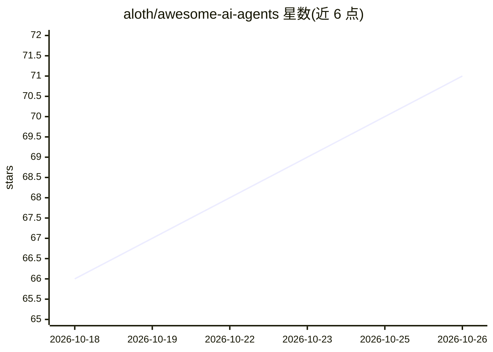

# aloth/awesome-ai-agents

⭐ 71 · CC0-1.0 · 推送 2026-10-25 · [GitHub](https://github.com/aloth/awesome-ai-agents) · 个人维护

**AI agent 框架、工具与研究资源的策展清单**

以 awesome list 形式收录 AI agent 生态项目：涵盖多智能体编排框架（AutoGen、CrewAI、LangGraph、AgentScope 等）、单智能体框架（LangChain、LlamaIndex、PydanticAI 等）、代码 agent（Claude Code、Aider、OpenCode、Cursor 等）以及平台与研究资源。条目附一句话描述与许可证信息，接受 PR 贡献，采用 CC0-1.0 许可。本体为清单而非软件，无安装运行流程。

## 筛选速览

| 维度 | 判定 | 备注 |
|---|---|---|
| AI 角色 | `ai-knowledge` | 知识聚合/清单类 |
| 许可风险 | `viral` | CC0-1.0 |
| 部署形态 | `library` | 以包/库形式分发 |
| 模型依赖 | — | README 未给出锁定关系 |
| 硬件要求 | — | 无带数字的原话,不猜 |
| 安装摩擦 | `high` | 编译与系统依赖俱全 |
| 成熟度 | — | 结构信号不足 |

## 能力要点

- 按多智能体编排、单智能体、代码 agent 等类别组织条目
- 每条目附项目描述与许可证信息
- 开放 PR 贡献的项目收录机制

## 适用场景

- 选型前查找和比较 AI agent 框架
- 了解 agent 生态中代码 agent 工具的分布
- 为研究方向收集 agent 相关开源项目线索

## 场景标签

`精选清单` · 领域:学习与行业

## 证据(README 行号)

> L5: > A curated list of AI agent frameworks, tools, platforms, research papers, and resources.
> L7: AI Agents are autonomous systems that use LLMs to reason, plan, and take actions. This list tracks the rapidly evolv

## 星数曲线

2026-10-18 66 → 2026-10-26 71（+5）

---
*卡片 v1 · prompt 1.4 · 生成 2026-10-24 · 置信度 mid · 依据 README sha `8120dbcc7f5c` · [字段定义](../../DATASET.md)*
