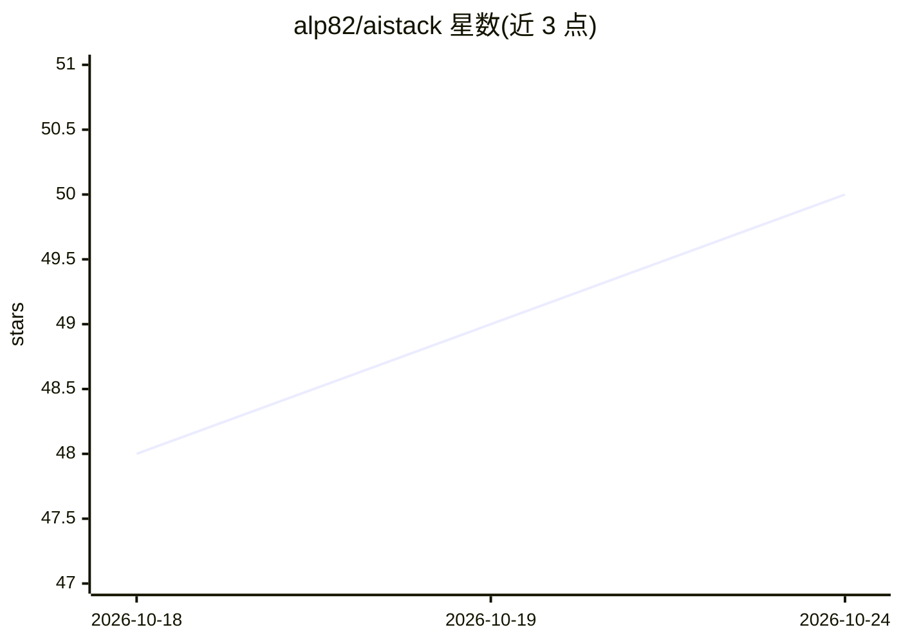

# alp82/aistack

⭐ 50 · TypeScript · MIT · 推送 2026-10-06 · [GitHub](https://github.com/alp82/aistack) · [官网](https://aistack.to) · 个人维护

**AI 技术栈的发现、对比与分享平台（Web + CLI）**

由 Web 应用（aistack.to）与 npm CLI（@use-aistack/cli）两部分组成：Web 端供开发者浏览、对比并发布 AI 技术栈，每个项目存放实际的 AI 配置文件（prompts、rules、skills、MCP servers）；CLI 负责 `collect` 扫描本地上传 .cursorrules、CLAUDE.md、AGENTS.md、mcp.json 等配置，`create` 在另一台机器上写回整套 AI 配置，并测量本地 AI 编码会话用量、默认每 6 小时自动同步统计数据（仅上传计数/模型名/工具名，不上传提示词与代码）。技术栈为 TanStack Start、React 19、Convex、Better Auth，MIT 许可。

## 筛选速览

| 维度 | 判定 | 备注 |
|---|---|---|
| AI 角色 | `ai-ecosystem` | LLM/agent 周边工具 |
| 许可风险 | `permissive` | MIT |
| 部署形态 | `library` | 以包/库形式分发 |
| 模型依赖 | — | README 未给出锁定关系 |
| 硬件要求 | — | 无带数字的原话,不猜 |
| 安装摩擦 | `low` | 无编译、无系统依赖或容器化 |
| 成熟度 | — | 结构信号不足 |

## 能力要点

- CLI 一条命令在多台机器间迁移 AI 配置（collect/create）
- 自动测量本地 AI 编码会话用量并按 6 小时周期同步统计
- 社区化浏览与并排对比 AI 技术栈
- 仅上传统计信息，提示词、响应、代码与文件路径不上传

## 适用场景

- 把我的 Cursor/Claude 等 AI 配置一键搬到新机器
- 对比别人的 AI 技术栈来选型和控费
- 在社区分享自己的 AI 工作流配置

## 场景标签

`提示工程` · 领域:Agent 开发

## 证据(README 行号)

> L19: AI Stack helps developers and teams **discover, compare, and share AI technology stacks**. Whether you are building
> L45: 2. **The CLI** (`@use-aistack/cli`) - a small tool that measures local AI coding sessions, syncs project config fil
> L52: - Run `npx @use-aistack/cli collect` inside your repo to upload your `.cursorrules`, `CLAUDE.md`, `AGENTS.md`, skil

## 星数曲线

2026-10-18 48 → 2026-10-24 50（+2）

---
*卡片 v1 · prompt 1.4 · 生成 2026-10-24 · 置信度 high · 依据 README sha `bba74732d2ed` · [字段定义](../../DATASET.md)*
