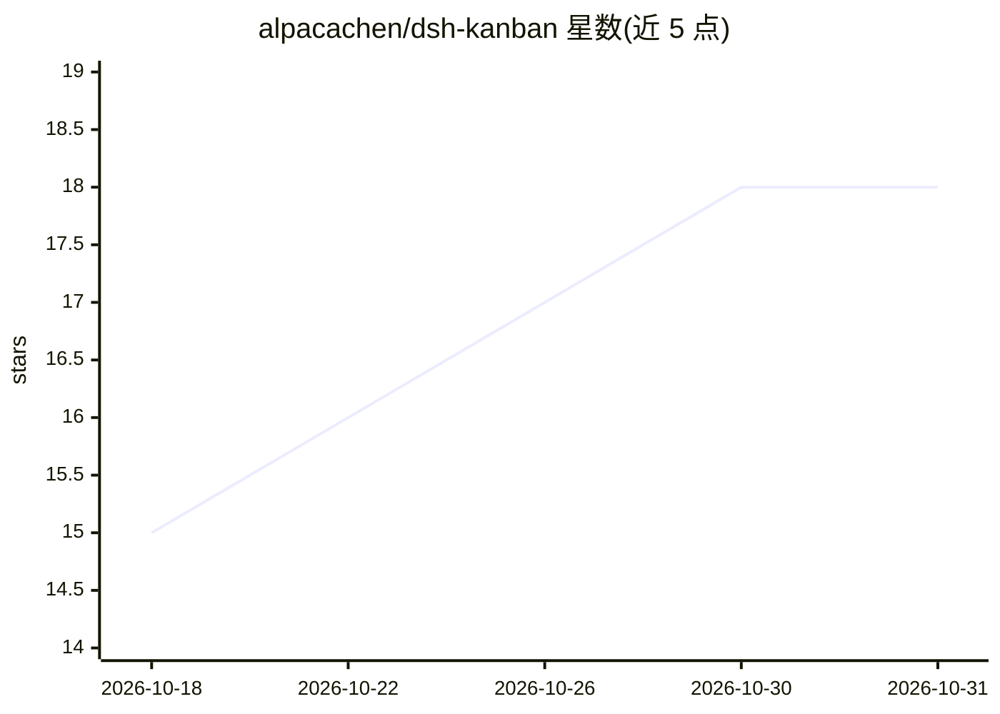

# alpacachen/dsh-kanban

⭐ 18 · JavaScript · MIT · 推送 2026-10-30 · [GitHub](https://github.com/alpacachen/dsh-kanban) · 个人维护 · 中文 README

**DeepSeek Harness 的共享看板插件：人与 AI agent 协同管理任务**

DeepSeek Harness 的插件，在 DSH 工作区内置协作看板：用户通过 UI 拖拽、编辑、筛选卡片，AI agent 通过 16 个 kanban_* 工具在同一看板上创建/更新/移动卡片、添加评论。用户可将对话中的计划直接转化为带优先级、标签、截止日期的任务卡，也可将任意卡片连同上下文发回对话。卡片描述使用 Markdown（限 2,000 字符），完成列自动记录完成时间。以预构建插件形式经 dsh plugin 命令安装，无需前端构建。

## 筛选速览

| 维度 | 判定 | 备注 |
|---|---|---|
| AI 角色 | `ai-ecosystem` | LLM/agent 周边工具 |
| 许可风险 | `permissive` | MIT |
| 部署形态 | `None` |  |
| 模型依赖 | locked-api |  |
| 硬件要求 | — | 无带数字的原话,不猜 |
| 安装摩擦 | `low` | 无编译、无系统依赖或容器化 |
| 成熟度 | — | 结构信号不足 |

## 能力要点

- 16 个内置 kanban_* 工具供 agent 操作看板
- 人与 agent 共享同一任务看板，双向同步
- Markdown 描述、P0-P2 优先级、标签、截止日期与活动时间线
- 卡片可携带上下文发送至当前或新对话

## 适用场景

- 把对话里 AI 生成的计划直接落成看板任务
- 与 AI agent 协同推进和追踪项目工作
- 管理带优先级、标签与截止日期的工作流

## 场景标签

 · 领域:项目管理/开发工具

## 证据(README 行号)

> L5: A collaborative kanban board where you and your AI agent plan, organize, and ship work together—without leaving Deep
> L108: The plugin automatically gives the agent these tools in every workspace:
> L58: dsh plugin --profile web add @alpacachen/dsh-kanban

## 星数曲线

2026-10-18 15 → 2026-10-31 18（+3）

---
*卡片 v1 · prompt 1.4 · 生成 2026-10-29 · 置信度 high · 依据 README sha `da880ee8ba43` · [字段定义](../../DATASET.md)*
