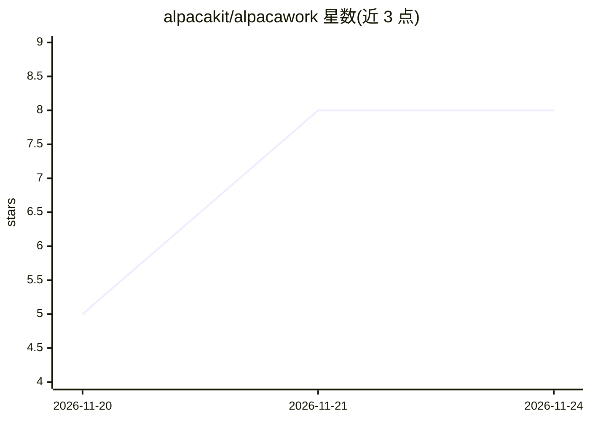

# alpacakit/alpacawork

⭐ 8 · TypeScript · MIT · 推送 2026-11-22 · [GitHub](https://github.com/alpacakit/alpacawork) · 个人维护

**让协调 AI 为你分派和跟踪 Claude Code/Codex 任务的开源工具**

alpacawork 是运行在个人 PC 上的 AI harness：调用已安装的 Claude Code 与 Codex 代理并分派任务。用户在单一聊天框输入请求，协调 AI（coordinator）将其拆解为任务、分配给其他 AI 并跟踪进度；AI 的提问带选项与推荐，报告可含图片与视频。提供手机端界面，可经 VPN（如 Tailscale）远程使用。通过 npm 全局安装，需 Node.js 24.16+ 与已登录的编码代理；任务与文件保留在本地，AI 调用按用户既有订阅计费。代理以无审批模式启动，可通过项目策略限制行为。

## 筛选速览

| 维度 | 判定 | 备注 |
|---|---|---|
| AI 角色 | `ai-ecosystem` | LLM/agent 周边工具 |
| 许可风险 | `permissive` | MIT |
| 部署形态 | `library` | 以包/库形式分发 |
| 模型依赖 | locked-api |  |
| 硬件要求 | — | 无带数字的原话,不猜 |
| 安装摩擦 | `low` | 无编译、无系统依赖或容器化 |
| 成熟度 | — | 结构信号不足 |

## 能力要点

- 单一聊天框输入，协调 AI 拆解任务并分配给多个代理并行工作
- 代理间交接工作流：多方案生成、交叉评审、汇总修改可用自然语言描述
- 手机优化界面，可远程回答问题、验收结果
- 兼容既有 AGENTS.md、CLAUDE.md、skills、MCP 与 hooks，无需注册或 API key

## 适用场景

- 离开电脑时用手机向家里的编码代理下任务并跟进
- 同时推进多个编码任务而无需在多个 AI 会话间切换
- 用一句话描述多步骤工作流（生成多方案→评审→合并）由 AI 协作完成

## 场景标签

`多智能体` `编码 Agent` `AI 助手` · 领域:Agent 开发

## 证据(README 行号)

> L19: alpacawork is a tool (an AI harness) that runs the Claude Code and Codex agents already installed on your PC and as
> L44: - **AI manages several AIs at once.** To add to or change work in progress, you only tell the coordinator. Write "F

## 星数曲线

2026-11-20 5 → 2026-11-24 8（+3）

---
*卡片 v1 · prompt 1.4 · 生成 2026-11-21 · 置信度 high · 依据 README sha `a1f29c103101` · [字段定义](../../DATASET.md)*
