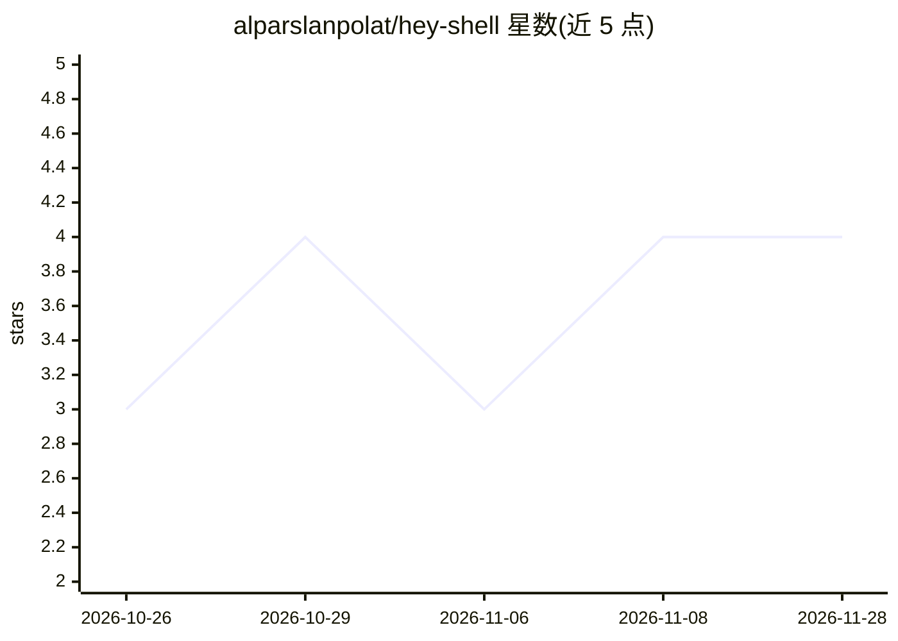

# alparslanpolat/hey-shell

⭐ 4 · Shell · MIT · 推送 2026-10-28 · [GitHub](https://github.com/alparslanpolat/hey-shell) · [官网](https://hey-shell.com) · 个人维护

**用自然语言按键生成待审 shell 命令的 CLI 插件**

在 bash/zsh/fish 中以快捷键（默认 Ctrl+G）把自然语言请求替换为 shell 命令，命令从不自动执行，需用户审阅后回车。命令由已登录的 agent CLI 生成，默认 Claude Code，可切换 Codex CLI 或 Gemini CLI；附带 hse 解释、hsf 修复、hsr 风险评级、hsc 失败预测（基于 bash -n 等静态解析与只读探测）等辅助命令。安装走 curl 脚本或 git clone 手动安装，也可作为 Claude Code 插件安装。

## 筛选速览

| 维度 | 判定 | 备注 |
|---|---|---|
| AI 角色 | `ai-native` | 本体是模型或模型工具 |
| 许可风险 | `permissive` | MIT |
| 部署形态 | `self-host` | docker 或自建部署 |
| 模型依赖 | locked-api |  |
| 硬件要求 | — | 无带数字的原话,不猜 |
| 安装摩擦 | `low` | 无编译、无系统依赖或容器化 |
| 成熟度 | — | 结构信号不足 |

## 能力要点

- 按键将自然语言替换为 shell 命令，且从不自动执行
- 支持 bash、zsh、fish，运行于 Linux、WSL2、macOS
- hsc 失败预测：语法解析、程序存在性检查、只读环境探测
- 可按已装工具（rg、fd、jq、gh）与项目上下文生成命令

## 适用场景

- 不熟悉 shell 语法时用自然语言得到可审阅的命令
- 命令执行失败后用 hsf 获取修正版本
- 运行前用 hsw/hsc 解释并预测命令风险

## 场景标签

`代码生成` · 领域:编码与开发

## 证据(README 行号)

> L11: Type what you want in plain language, press a key (**Ctrl+G** by default, configurable), and your prompt line is re
> L29: Works in bash, zsh and fish on Linux, WSL2 and macOS. The commands come from the AI agent CLI you already use and a

## 星数曲线

2026-10-26 3 → 2026-11-28 4（+1）

---
*卡片 v1 · prompt 1.4 · 生成 2026-11-21 · 置信度 mid · 依据 README sha `34977d42ef08` · [字段定义](../../DATASET.md)*
