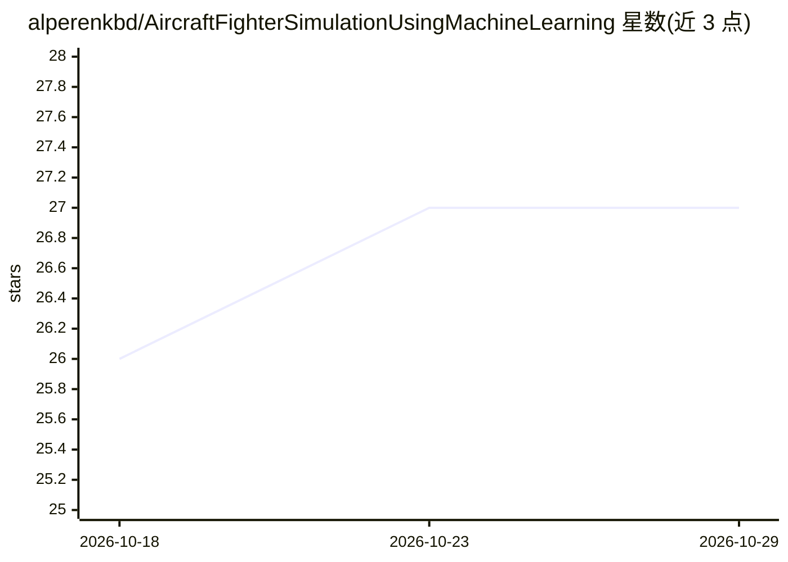

# alperenkbd/AircraftFighterSimulationUsingMachineLearning

⭐ 27 · C# · 推送 2025-11-04 · [GitHub](https://github.com/alperenkbd/AircraftFighterSimulationUsingMachineLearning) · 个人维护

**Unity3D 空战模拟：用强化学习训练敌机 AI 的开源仿真项目**

基于 Unity3D 与 C# 开发的战斗机模拟项目，面向仿真训练与军事/严肃游戏领域的开发者和学习者。系统通过 Web API 获取实时天气，按系统时钟划分三个时段，组合出 12 种（3×4）仿真环境；敌方飞机由 Unity ML-Agents 强化学习训练。支持 Arduino 电位器自制操纵杆与键盘两种控制方式，当前支持英语和土耳其语。开发环境为 Unity 2019.4.11f1，使用 Post-Processing 渲染栈。README 未给出安装/运行命令。

## 筛选速览

| 维度 | 判定 | 备注 |
|---|---|---|
| AI 角色 | `ai-native` | 本体是模型或模型工具 |
| 许可风险 | `none` | — |
| 部署形态 | `None` |  |
| 模型依赖 | — | README 未给出锁定关系 |
| 硬件要求 | — | 无带数字的原话,不猜 |
| 安装摩擦 | `medium` | 含编译或系统依赖之一 |
| 成熟度 | — | 结构信号不足 |

## 能力要点

- 强化学习（ML-Agents）训练敌方飞机行为
- Web API 实时天气 + 系统时钟，组合 12 种仿真环境
- Arduino 自制操纵杆与键盘双控制模式
- 英语/土耳其语双语支持，架构便于扩展更多语言

## 适用场景

- 在低成本仿真环境中复现空战训练场景，减少实机损耗
- 学习 Unity ML-Agents 强化学习在仿真中的用法
- 在同一空战环境中开发并对比不同智能体算法

## 场景标签

 · 领域:仿真/严肃游戏

## 证据(README 行号)

> L10: We built a project to address these problems. The system fetches real‑time weather via a web API and uses the syste
> L48: - Unity-Technologies/Ml-Agents

## 星数曲线

2026-10-18 26 → 2026-10-29 27（+1）

---
*卡片 v1 · prompt 1.4 · 生成 2026-10-26 · 置信度 mid · 依据 README sha `975c69de8274` · [字段定义](../../DATASET.md)*
