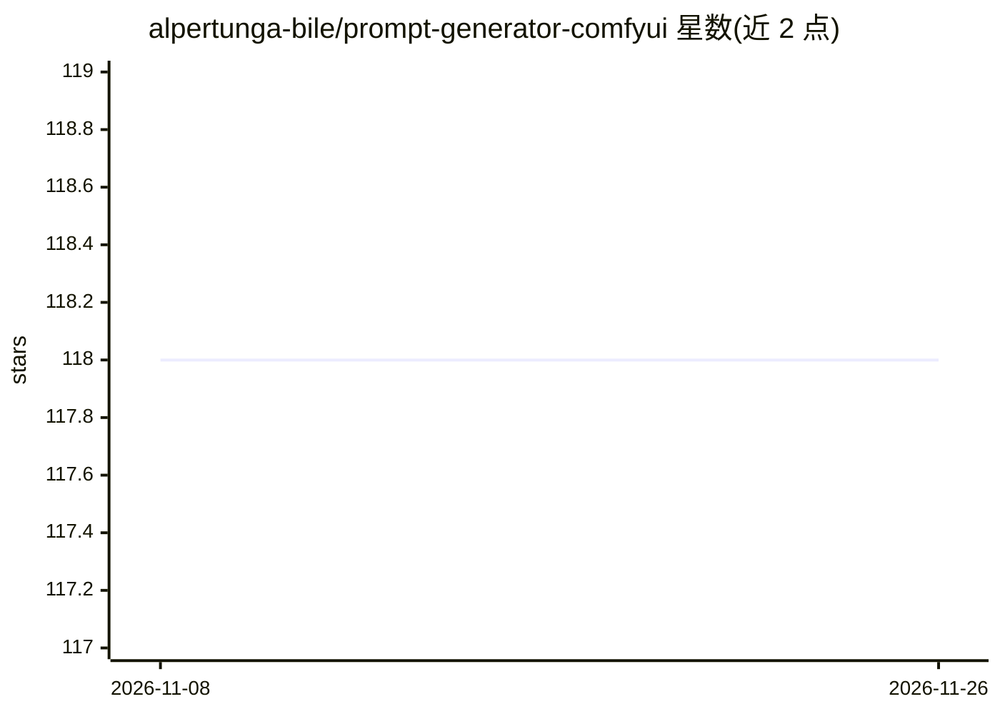

# alpertunga-bile/prompt-generator-comfyui

⭐ 118 · Python · MIT · 推送 2026-11-06 · [GitHub](https://github.com/alpertunga-bile/prompt-generator-comfyui) · 个人维护

**ComfyUI 自定义节点：用文本生成模型产出绘画提示词**

面向 ComfyUI 用户的提示词生成节点：加载放置于 models/prompt_generators 目录的文本生成模型（支持 Transformers 模型、Lora adapter），从种子提示词生成图像生成用的提示词。提供一次生成 5 个输出按 index/random_index 选取、递归生成（self_recursive 与否对应随机或更精确模式）、输出预处理去重（exact_keyword/exact_prompt/none）、Quanto/Bitsandbytes 量化、token healing 等机制。作者在 README 提供 distilgpt2、bloom-560m 等预训练模型及 HuggingFace 数据集。安装方式覆盖便携版手动安装与 ComfyUI Manager 自动安装。

## 筛选速览

| 维度 | 判定 | 备注 |
|---|---|---|
| AI 角色 | `ai-native` | 本体是模型或模型工具 |
| 许可风险 | `permissive` | MIT |
| 部署形态 | `desktop` | 安装包/桌面程序 |
| 模型依赖 | — | README 未给出锁定关系 |
| 硬件要求 | — | 无带数字的原话,不猜 |
| 安装摩擦 | `low` | 无编译、无系统依赖或容器化 |
| 成熟度 | — | 结构信号不足 |

## 能力要点

- 加载 Transformers/Lora adapter 文本生成模型产出提示词
- 一次生成 5 个输出，可按 index 或随机选取，支持 lock 锁定
- 递归生成与输出预处理去重（exact_keyword/exact_prompt）
- Quanto/Bitsandbytes 量化支持（依据环境自动选择）

## 适用场景

- 在 ComfyUI 工作流中自动生成图像提示词
- 用递归模式从种子词扩展多样化提示词
- 低显存环境通过量化运行提示词生成模型

## 场景标签

`提示工程` · 领域:Agent 开发

## 证据(README 行号)

> L6: Custom AI prompt generator node for
> L8: use text generation models to generate prompts. Before using, text generation

## 星数曲线

2026-11-08 118 → 2026-11-26 118（+0）

---
*卡片 v1 · prompt 1.4 · 生成 2026-11-17 · 置信度 mid · 依据 README sha `4f72ebb1f6c6` · [字段定义](../../DATASET.md)*
