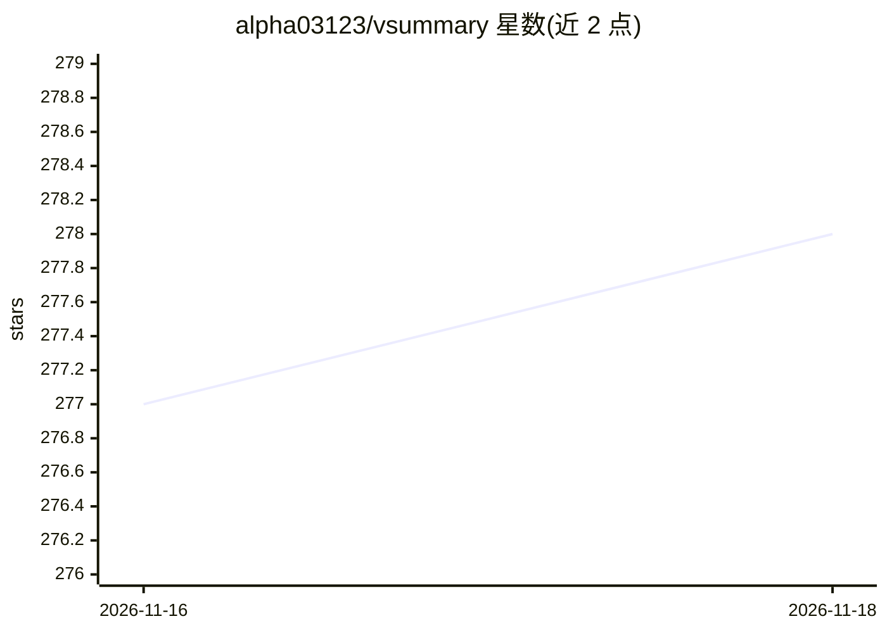

# alpha03123/vsummary

⭐ 278 · Python · Apache-2.0 · 推送 2026-11-16 · [GitHub](https://github.com/alpha03123/vsummary) · [官网](https://vsummary.net/) · 个人维护 · 中文 README

**面向普通用户的视频 AI 总结与本地知识库工具**

将 B站/YouTube/抖音链接或本地视频转写为文本，生成章节纪要、AI 概况、思维导图与知识卡片，支持单视频与系列范围的对话问答，章节可跳转视频对应时间。提供 MCP 工具让 AI 助手自动化导入、处理与导出 Markdown。本地优先：视频、转写、摘要与索引存于本地目录，仅调用用户配置的模型供应商。提供 Windows CPU/GPU 整合包（解压运行 start.bat）、macOS 源码运行（whisper.cpp/Metal）与 Chrome 浏览器插件，另提供在线版 vsummary.net。

## 筛选速览

| 维度 | 判定 | 备注 |
|---|---|---|
| AI 角色 | `ai-native` | 本体是模型或模型工具 |
| 许可风险 | `permissive` | Apache-2.0 |
| 部署形态 | `library` | 以包/库形式分发 |
| 模型依赖 | — | README 未给出锁定关系 |
| 硬件要求 | — | 无带数字的原话,不猜 |
| 安装摩擦 | `low` | 无编译、无系统依赖或容器化 |
| 成熟度 | `idea` | |

## 能力要点

- 视频转写后生成章节纪要、AI 概况、思维导图和知识卡片
- 单视频与跨视频系列的 RAG 式问答，编号可跳转原文时间点
- MCP 工具支持 AI 助手自动化导入、处理与导出 Markdown
- 本地优先存储，Windows 提供 CPU/GPU 整合包一键启动

## 适用场景

- 把课程、讲座、播客等成组视频整理成可检索的学习资料
- B站看视频时用侧边栏插件直接查看 AI 概括与章节
- 围绕多个视频的内容向本地知识库提问
- 让 AI 助手通过 MCP 批量整理本地录音并导出总结

## 场景标签

`语音识别` `知识库管理` · 领域:知识与检索

## 证据(README 行号)

> L5: 视频AI总结，对话的本地知识库工具
> L64: - **把视频变成可检索的知识库**：导入本地视频后，自动整理出转写文本、概况、章节和关键结论。后续可以直接围绕内容提问，把视频作为自己的本地知识库。支持导出为MD。
> L71: - **本地优先**：原始视频、转写结果、摘要、笔记和知识索引都保存在本地目录中；除了调用你配置的模型供应商外，不需要把视频上传到第三方平台。

## 星数曲线

2026-11-16 277 → 2026-11-18 278（+1）

---
*卡片 v1 · prompt 1.4 · 生成 2026-11-17 · 置信度 mid · 依据 README sha `c1713a28c8ad` · [字段定义](../../DATASET.md)*
